# relativity-rider

Ride a relativistic rocket in a terminal and watch your clock fall behind Earth's. A C11 special-relativity toy: exact hyperbolic motion at constant proper acceleration, Lorentz boosts, and a live spacetime diagram.
(C言語の特殊相対論シミュレータ。ロケットを加減速させ、時空図と固有時を観察します。)

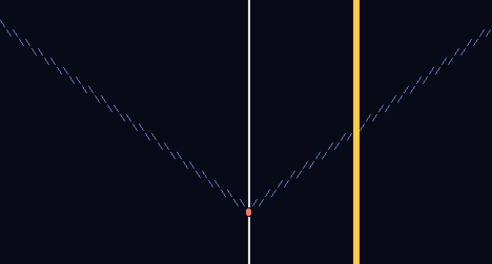

**Theory handbook**: [docs/theory/](docs/theory/README.md) — 13 statements (the invariant interval, the Lorentz transformation, rapidity and velocity addition, time dilation, length contraction, relativity of simultaneity, hyperbolic motion, the exact step, the flip-and-burn trip, the program's rules), each with its equation, assumptions, derivation, code, tests and a figure. `make theory-figs` regenerates the figures and the measured values; `make theory-check` checks the coverage table.

(理論の手引き: 式・前提・導出・実装箇所・検査を、全項目に図つきで説明します。)

## Browser observatory

The same C model, compiled to WebAssembly, drives a browser spacetime diagram in the Earth frame: hold **Accelerate** / **Decelerate** (or `W` / `S`, or touch) for a constant proper acceleration of about 1 g, and try to stop on the star. The rocket's computed worldline is orange, the light cone of the departure is the dashed blue line (nothing crosses it), the star is the yellow line at 4.2 ly and the dashed purple line is the rocket's "now" (events with the same ship time). Two clock cards follow Vela, who rides the rocket (ship time τ), and Oren, the twin who stays on Earth (Earth time t). A locked experiment flies the exact 1 g flip-and-burn trip: 3.53 yr on board, 5.82 yr on Earth.

| Terminal (before) | Browser observatory (after) |
|---|---|
| 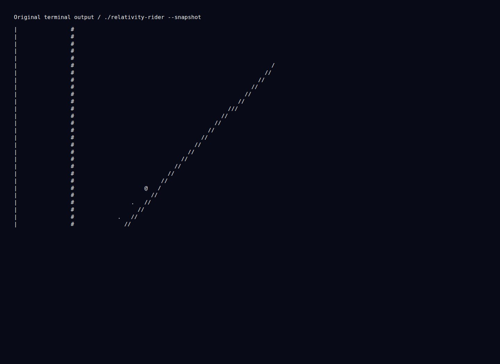 | 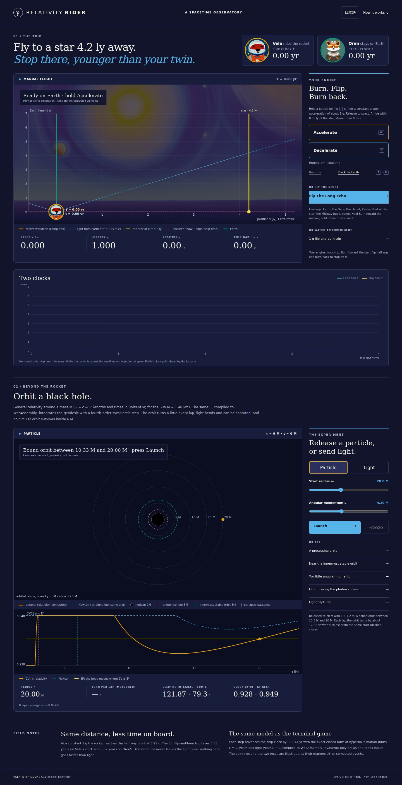 |

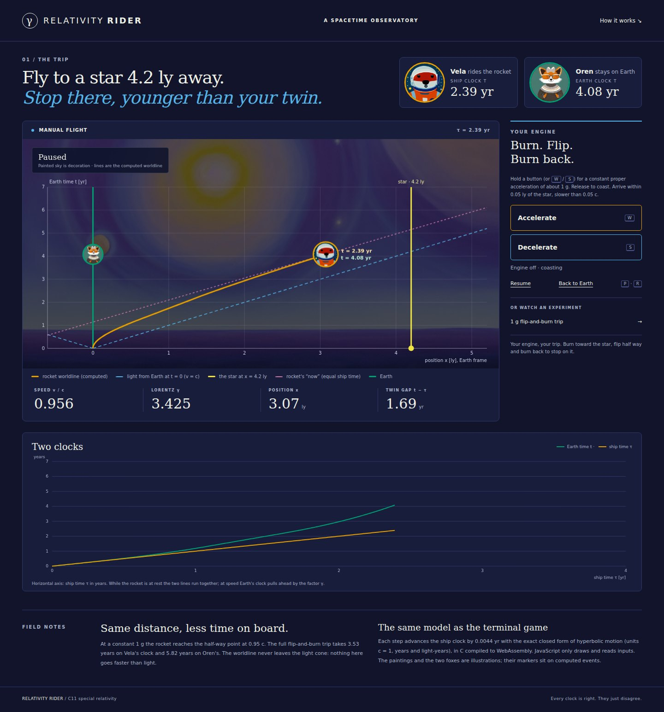
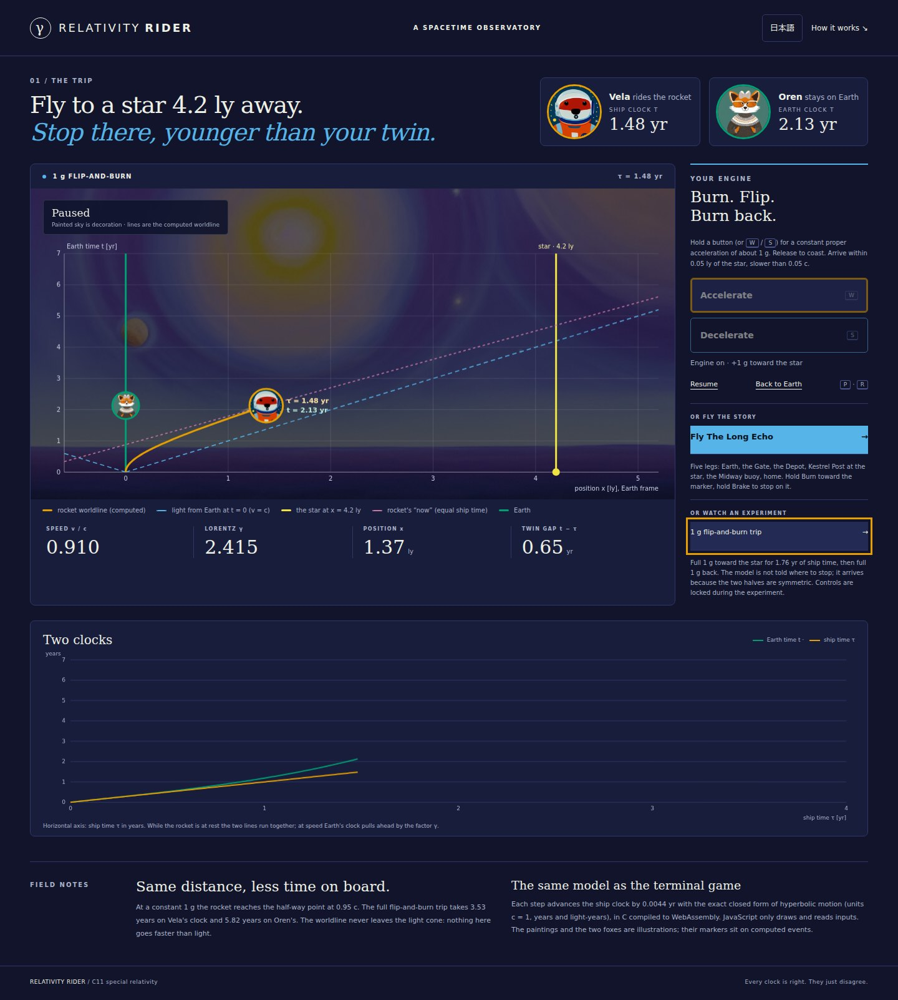
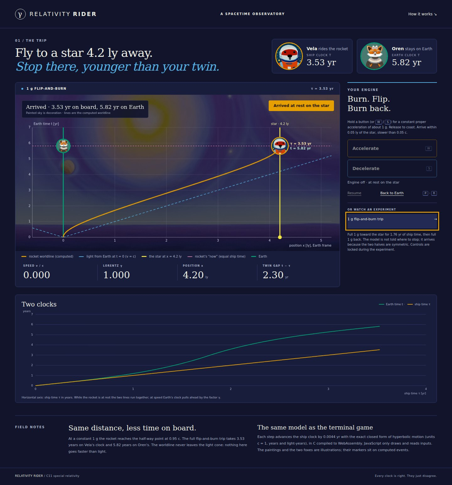
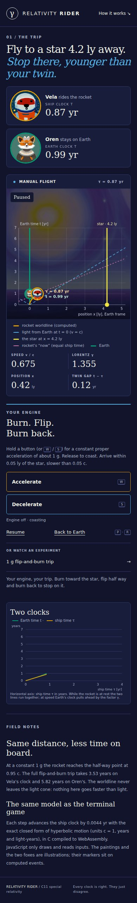

The painted sky and the two foxes are original illustrations generated locally (see [docs/art-direction.md](docs/art-direction.md)). Their markers sit on computed events (the rocket's current event and Earth at the same Earth time); they are decoration, not extra physics.

## Run

```sh
make && ./relativity-rider          # interactive
./relativity-rider --snapshot       # one frame, no terminal needed
./relativity-rider --gif docs/demo.gif  # scripted flip-and-burn trip as an animated GIF
make test && make plots             # unit tests and docs/*.svg
docker build -t relativity-rider .  # same, reproducibly
make web && make play               # browser observatory at http://localhost:4217 (needs emcc)
make smoke                          # native/WASM comparison, real controls, screenshots (needs Playwright)
```

Keys: `w` accelerate, `s` decelerate (about 1 g), `p` pause, `q` quit. Stop at the `#` star 4.2 ly away. In the diagram `/` and `\` are the light cone of the departure event, `@` is you, `.` is your past worldline.

## Model

Units with `c = 1` (years, light-years). With rapidity `φ` (`v = tanh φ`, `γ = cosh φ`) and proper acceleration `a`:

```
t(τ) = sinh(aτ)/a        x(τ) = (cosh(aτ) − 1)/a        (from rest)
```

Each step uses the exact closed form, so there is no integration error.

## Results

A 1 g flip-and-burn trip to 4.2 ly: accelerate for half the trip, flip, decelerate. The traveller ages 3.53 yr while 5.82 yr pass on Earth.

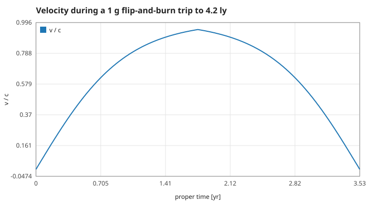
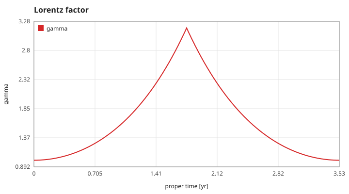
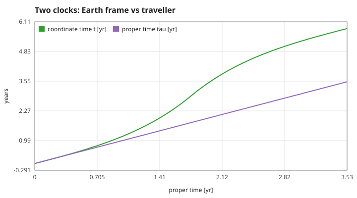
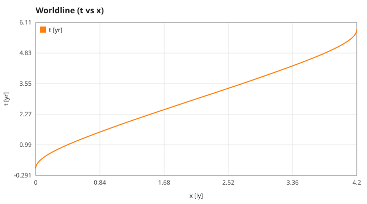

## Tests

`tests/test_relativity.c` checks: closed-form hyperbolic motion (1e-9), the worldline stays on the hyperbola, time dilation at γ = 2, boosts preserve the interval and invert cleanly, velocity addition never exceeds c and rapidities add, the flip-and-burn trip arrives at rest on target, renderer bounds.

`tests/test_rider.c` checks that the browser adapter moves exactly like the Rocket API (bit-identical over 1,800 steps), that the scripted trip flips at 2.1 ly and stops on the star at rest with τ = 2·acosh(1 + a·d/2)/a and t = 2·sinh(a·τ/2)/a, that every worldline segment is timelike, and the manual arrival rule. `scripts/smoke.cjs` compares WASM with the native trace and flies the trip with the real buttons (results in `docs/validation.json`).

## Roadmap

See the Issues: Schwarzschild orbits (general relativity), twin-paradox turnaround view, relativistic aberration.

Part of a series of small C physics toys, tracked in [algo-vis-panel](https://github.com/TM-59/algo-vis-panel/issues/6). MIT licensed.
