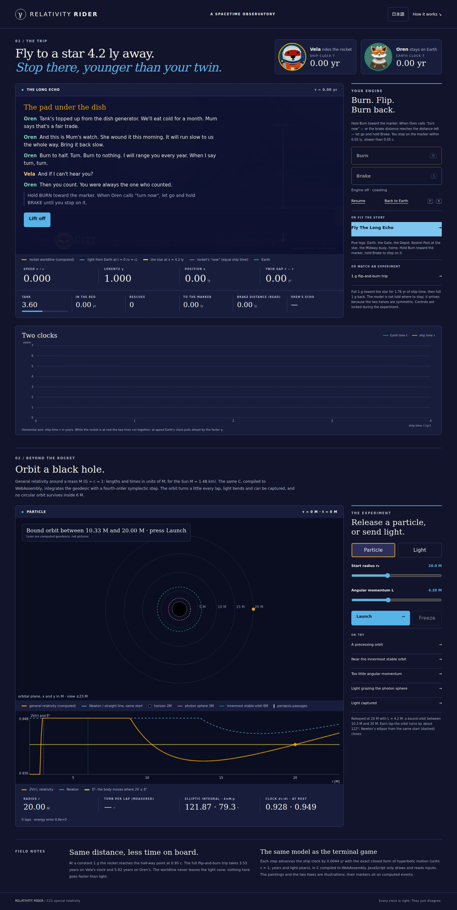
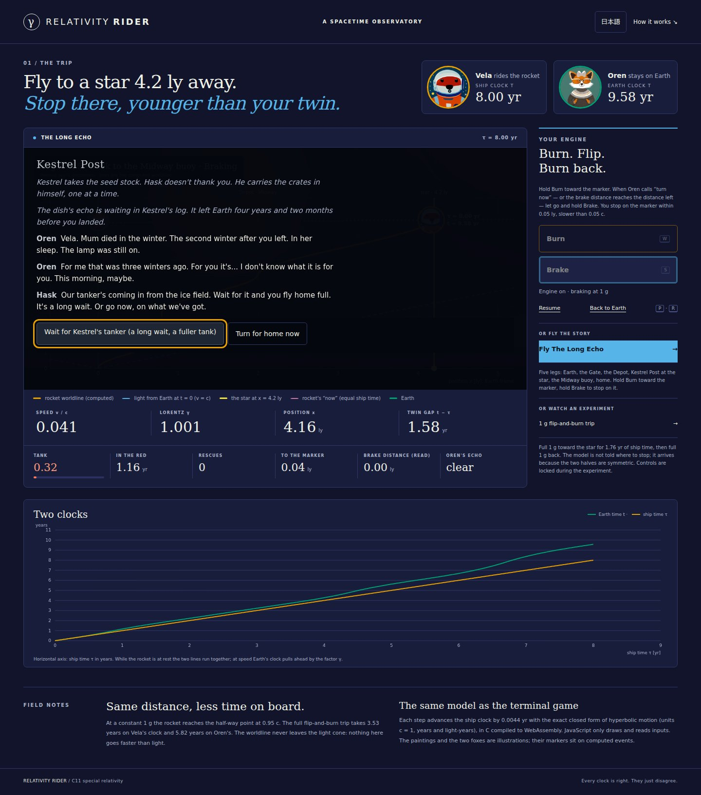
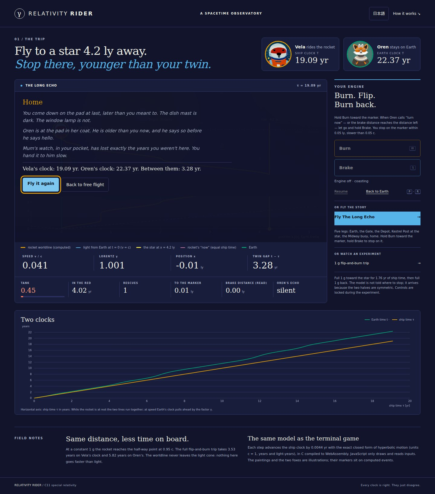
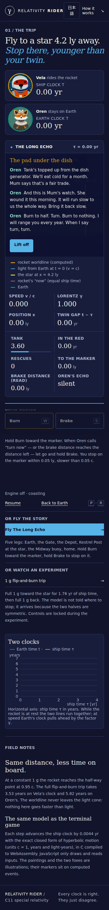
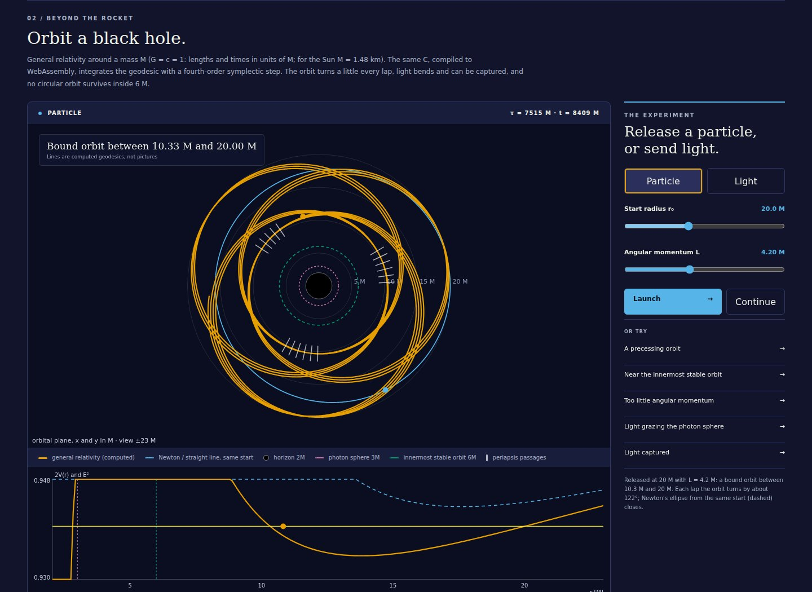
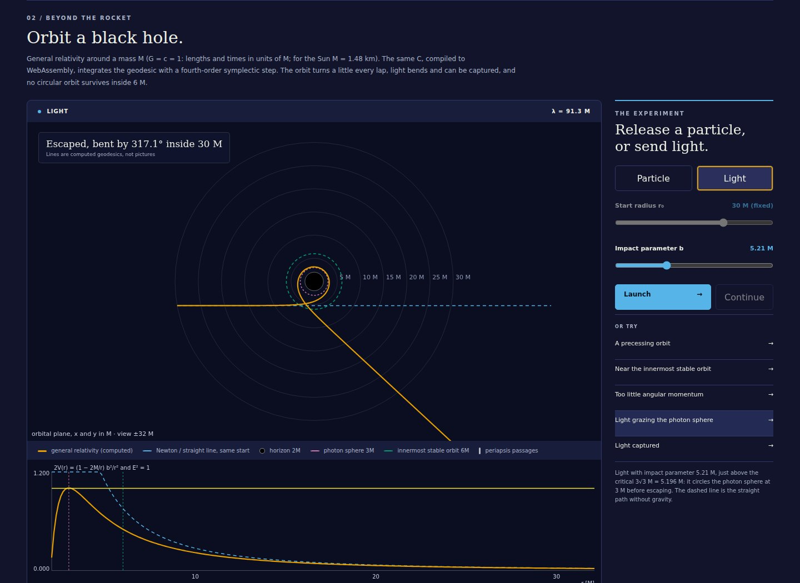
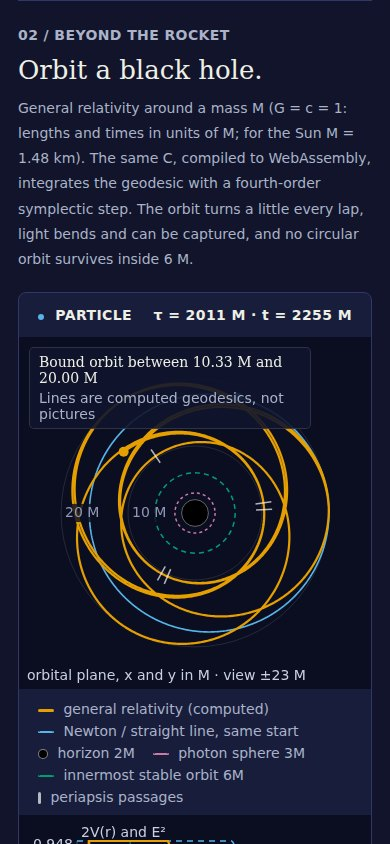
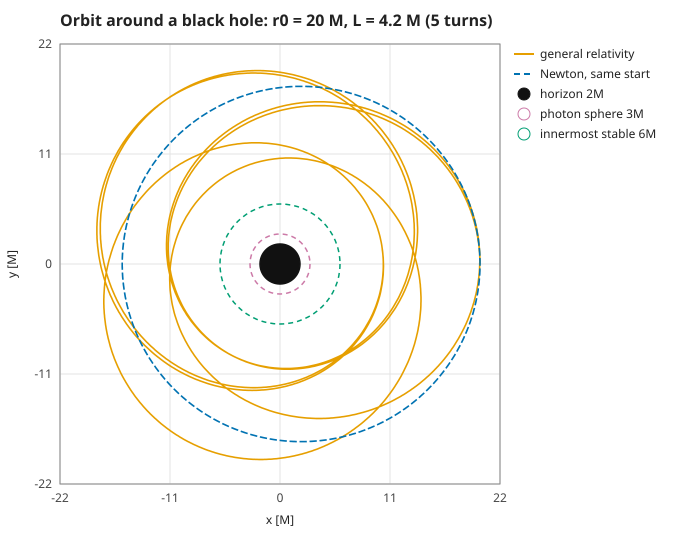

# relativity-rider

Ride a relativistic rocket in a terminal and watch your clock fall behind Earth's. A C11 special-relativity toy: exact hyperbolic motion at constant proper acceleration, Lorentz boosts, and a live spacetime diagram.
(C言語の特殊相対論シミュレータ。ロケットを加減速させ、時空図と固有時を観察します。)


**Theory handbook**: [docs/theory/](docs/theory/README.md) — 30 statements (the invariant interval, the Lorentz transformation, rapidity and velocity addition, time dilation, length contraction, relativity of simultaneity, hyperbolic motion, the exact step, the flip-and-burn trip, the program's rules, the story trip's rules, and — on [page 5](docs/theory/05-schwarzschild.md) — orbits around a black hole: Schwarzschild geodesics, the effective potential, circular orbits and the innermost stable one at 6M, the photon sphere, the bending of light, the periapsis precession, clocks near the hole, falling in, the fourth-order symplectic integrator and Newton's limit), each with its equation, assumptions, derivation, code, tests and a figure. `make theory-figs` regenerates the figures and the measured values; `make theory-check` checks the coverage table.

(理論の手引き: 式・前提・導出・実装箇所・検査を、全項目に図つきで説明します。)

## Browser observatory

The same C model, compiled to WebAssembly, drives a browser spacetime diagram in the Earth frame: hold **Accelerate** / **Decelerate** (or `W` / `S`, or touch) for a constant proper acceleration of about 1 g, and try to stop on the star. The rocket's computed worldline is orange, the light cone of the departure is the dashed blue line (nothing crosses it), the star is the yellow line at 4.2 ly and the dashed purple line is the rocket's "now" (events with the same ship time). Two clock cards follow Vela, who rides the rocket (ship time τ), and Oren, the twin who stays on Earth (Earth time t). A locked experiment flies the exact 1 g flip-and-burn trip: 3.53 yr on board, 5.82 yr on Earth.

| Terminal (before) | Browser observatory (after) |
|---|---|
|  |  |


### The Long Echo (story mode)

**Fly The Long Echo** sends Vela out with seed stock for Kestrel Post at the star and home again in five legs: Earth, the Gate (0.8 ly), the Depot (2.0 ly), Kestrel Post (4.2 ly), the Midway buoy (2.0 ly) and Earth. Hold **Burn** toward the marker, and when Oren calls "turn now" (or the brake distance on the panel reaches the distance left) hold **Brake** to stop on it. Seven scenes, in English or Japanese (top bar), open at fixed progress points; two of them are choices that cost years on both clocks or fuel, and the second picks one of two endings. The story never moves the rocket by itself: every step is the same exact `rocket_step`, and the scenes change only the tank, a hold on a marker, how much the readout wobbles, a leak in the dust and what a rescue costs ([theory, page 4](docs/theory/04-story.md)).

| The pad | The echo at Kestrel | Home |
|---|---|---|
|  |  |  |



`make story` flies the trip with a human-like bench pilot and writes [docs/narrative/](docs/narrative/): the order of the scenes per seed, the outcomes (Earth years, ship years, time in the red, rescues) with the story numbers on, off and one beat off at a time, each choice per path, and the crises per leg over 192 runs. `make test` re-runs rows of those files and requires them verbatim.

### Orbit a black hole (general relativity)

Below the rocket, a second panel releases a particle around a black hole of mass M (units G = c = M = 1), or sends light past it. `src/schwarzschild.c` integrates the Schwarzschild geodesic with a fourth-order symplectic step (Yoshida's composition of the leapfrog) and `src/orbit.c` runs it beside Newton's orbit from the same start (for light, the straight line). Choose the start radius r₀ and the angular momentum L (or the impact parameter b for light), or a preset: a precessing orbit, the innermost stable orbit, too little angular momentum (it falls in, Newton's does not), light grazing the photon sphere, light captured. The panel draws the orbital plane with the horizon (2M), the photon sphere (3M) and the innermost stable circular orbit (6M), the effective potential with the level E², and reports the turn per lap measured at each periapsis beside the elliptic integral and the weak-field 6πM/p, the clocks (dτ/dt on the orbit and at rest) and the energy error. From r₀ = 20 M with L = 4.2 M the orbit turns 121.9° per lap (measured 2.1270940 rad, elliptic integral 2.1270940; 6πM/p gives only 79.3°).



| Light grazing the photon sphere | On a phone |
|---|---|
|  |  |

`./relativity-rider --orbit docs` writes the same orbit as a chart (also part of `make plots`):



The painted sky and the two foxes are original illustrations generated locally (see [docs/art-direction.md](docs/art-direction.md)). Their markers sit on computed events (the rocket's current event and Earth at the same Earth time); they are decoration, not extra physics.

## Run

```sh
make && ./relativity-rider          # interactive
./relativity-rider --snapshot       # one frame, no terminal needed
./relativity-rider --gif docs/demo.gif  # scripted flip-and-burn trip as an animated GIF
./relativity-rider --orbit docs     # an orbit around a black hole as docs/orbit.svg
make test && make plots             # unit tests and docs/*.svg
docker build -t relativity-rider .  # same, reproducibly
make web && make play               # browser observatory at http://localhost:4217 (needs emcc)
make smoke                          # native/WASM comparison, real controls, screenshots (needs Playwright)
```

Keys: `w` accelerate, `s` decelerate (about 1 g), `p` pause, `q` quit. Stop at the `#` star 4.2 ly away. In the diagram `/` and `\` are the light cone of the departure event, `@` is you, `.` is your past worldline.

## Model

Units with `c = 1` (years, light-years). With rapidity `φ` (`v = tanh φ`, `γ = cosh φ`) and proper acceleration `a`:

```
t(τ) = sinh(aτ)/a        x(τ) = (cosh(aτ) − 1)/a        (from rest)
```

Each step uses the exact closed form, so there is no integration error.

Around a black hole (geometric units G = c = M = 1) a free body has the conserved energy E and angular momentum L, and its radius obeys

```
(dr/dτ)²/2 + V(r) = E²/2,   V(r) = (1 − 2M/r)(1 + L²/r²)/2,   dφ/dτ = L/r²,   dt/dτ = E/(1 − 2M/r)
```

integrated as d²r/dτ² = −V′(r) by a fourth-order symplectic composition, so the energy error stays bounded (about 1e-11 over 100 laps).

## Results

A 1 g flip-and-burn trip to 4.2 ly: accelerate for half the trip, flip, decelerate. The traveller ages 3.53 yr while 5.82 yr pass on Earth.


## Tests

`tests/test_relativity.c` checks: closed-form hyperbolic motion (1e-9), the worldline stays on the hyperbola, time dilation at γ = 2, boosts preserve the interval and invert cleanly, velocity addition never exceeds c and rapidities add, the flip-and-burn trip arrives at rest on target, renderer bounds.

`tests/test_courier.c` checks the story layer: Burn is `rocket_step` at 1 g bit for bit with the story numbers on or off, the scene order, every number a scene changes, the heavy scenes shown without a banner, and that each choice trades one outcome for another in the bench.

`tests/test_schwarzschild.c` checks the black-hole orbits: the force is −dV/dr, E and L read back from the integrated clock and angle, circular orbits stay circular with dφ/dt = √(M/r³) and dτ/dt = √(1 − 3M/r), the innermost stable orbit at 6M (a nudge outside oscillates, inside falls in), capture of light below 3√3 M, the bending of light against the quadrature and 4M/b + (15π/4)(M/b)², the periapsis turn against the elliptic integral (1e-9) and 6πM/p, fourth-order convergence (second for the plain leapfrog), Newton's limit, the radial fall time, and the browser adapter. `scripts/smoke.cjs` also compares its WebAssembly build with `./test_schwarzschild --trace` and drives the panel's real controls.

`tests/test_rider.c` checks that the browser adapter moves exactly like the Rocket API (bit-identical over 1,800 steps), that the scripted trip flips at 2.1 ly and stops on the star at rest with τ = 2·acosh(1 + a·d/2)/a and t = 2·sinh(a·τ/2)/a, that every worldline segment is timelike, and the manual arrival rule. `scripts/smoke.cjs` compares WASM with the native trace and flies the trip with the real buttons (results in `docs/validation.json`).

## Roadmap

See the Issues: twin-paradox turnaround view, relativistic aberration.

Part of a series of small C physics toys, tracked in [algo-vis-panel](https://github.com/TM-59/algo-vis-panel/issues/6). MIT licensed.
