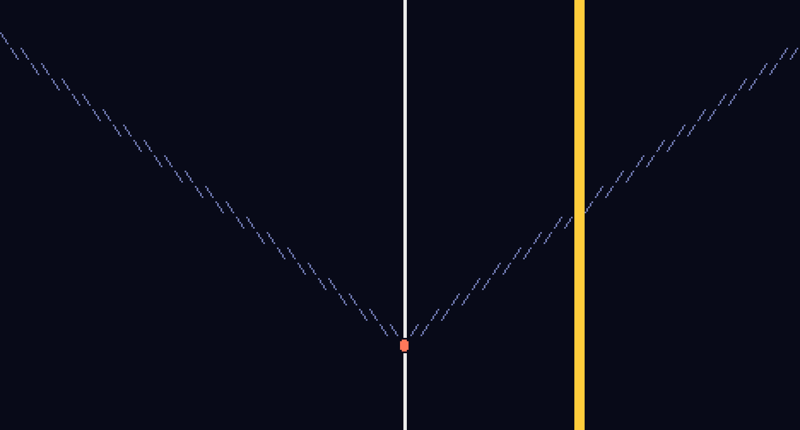
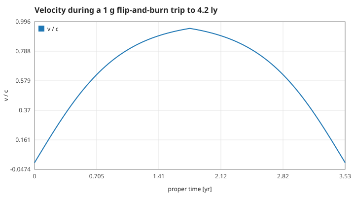
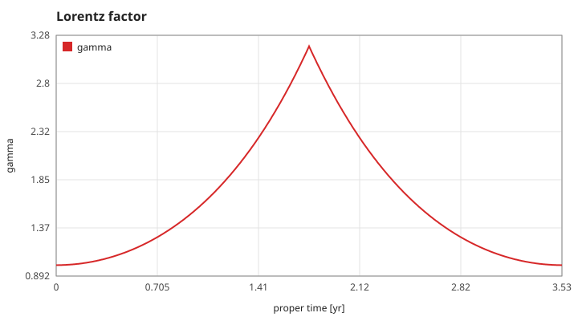
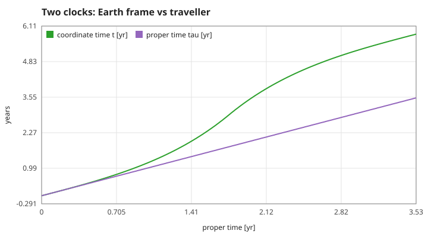
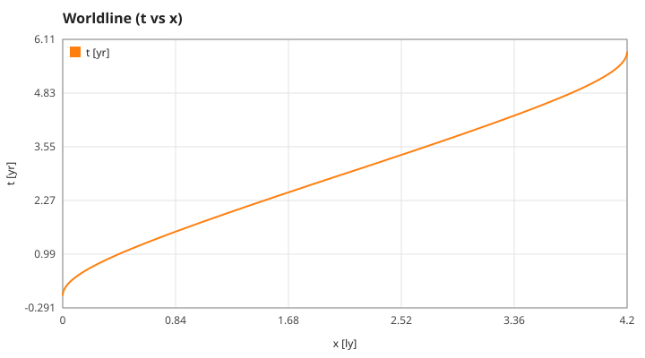

# relativity-rider

Ride a relativistic rocket in a terminal and watch your clock fall behind Earth's. A C11 special-relativity toy: exact hyperbolic motion at constant proper acceleration, Lorentz boosts, and a live spacetime diagram.
(C言語の特殊相対論シミュレータ。ロケットを加減速させ、時空図と固有時を観察します。)



## Run

```sh
make && ./relativity-rider          # interactive
./relativity-rider --snapshot       # one frame, no terminal needed
./relativity-rider --gif docs/demo.gif  # scripted flip-and-burn trip as an animated GIF
make test && make plots             # unit tests and docs/*.svg
docker build -t relativity-rider .  # same, reproducibly
```

Keys: `w` accelerate, `s` decelerate (about 1 g), `p` pause, `q` quit. Stop at the `#` star 4.2 ly away. In the diagram `/` and `\` are the light cone of the departure event, `@` is you, `.` is your past worldline.

## Model

Units with `c = 1` (years, light-years). With rapidity `φ` (`v = tanh φ`, `γ = cosh φ`) and proper acceleration `a`:

```
t(τ) = sinh(aτ)/a        x(τ) = (cosh(aτ) − 1)/a        (from rest)
```

Each step uses the exact closed form, so there is no integration error.

## Results

A 1 g flip-and-burn trip to 4.2 ly: accelerate for half the trip, flip, decelerate. The traveller ages 3.53 yr while 5.82 yr pass on Earth.






## Tests

`tests/test_relativity.c` checks: closed-form hyperbolic motion (1e-9), the worldline stays on the hyperbola, time dilation at γ = 2, boosts preserve the interval and invert cleanly, velocity addition never exceeds c and rapidities add, the flip-and-burn trip arrives at rest on target, renderer bounds.

## Roadmap

See the Issues: Schwarzschild orbits (general relativity), twin-paradox turnaround view, relativistic aberration.

Part of a series of small C physics toys, tracked in [algo-vis-panel](https://github.com/TM-59/algo-vis-panel/issues/6). MIT licensed.
