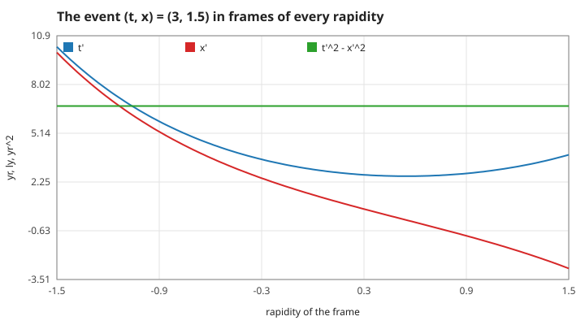
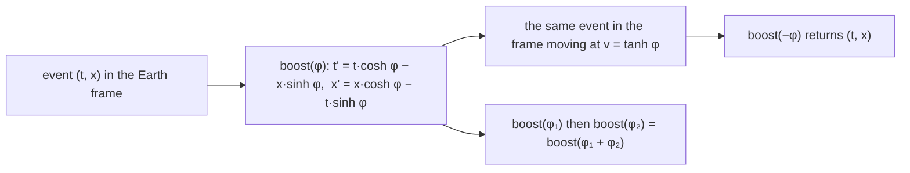
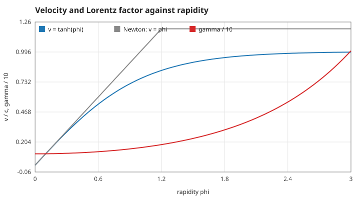
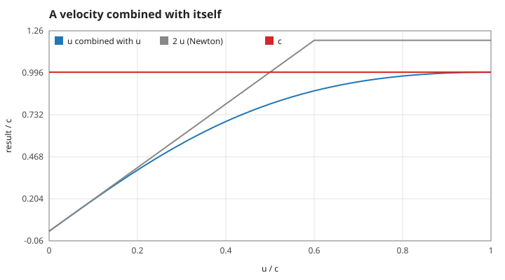
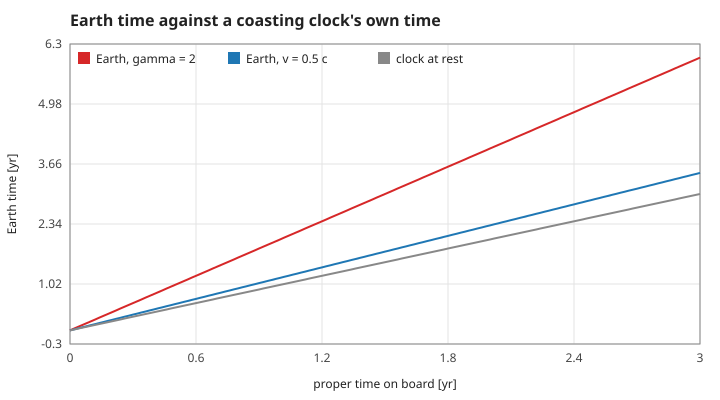
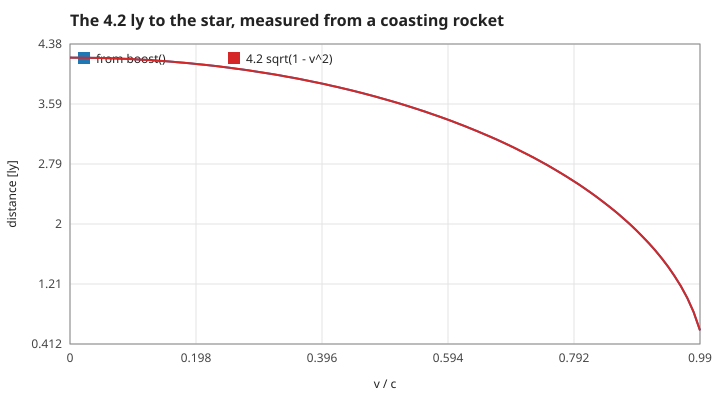
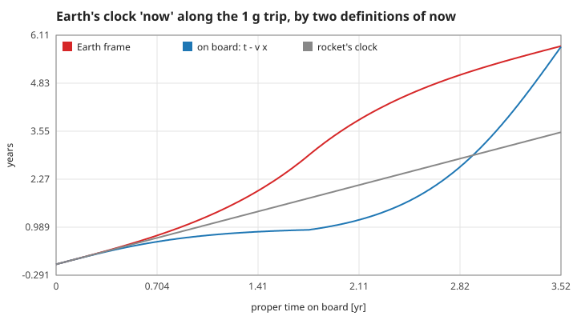

# 1. Spacetime: intervals, boosts, rapidity, clocks and rods

One space dimension and time, in units where $c = 1$: times in years, lengths in light-years, velocities as fractions of $c$. "Earth frame" is the frame in which Earth and the star 4.2 ly away are at rest. Measured numbers are quoted by their id in [figures/values.md](figures/values.md).

[Back to the index](README.md)

## S01 — The invariant interval and the light cone

**Statement.** For two events separated by $\Delta t$ and $\Delta x$ the quantity

$$s^2 = \Delta t^2 - \Delta x^2$$

has the same value in every inertial frame [Minkowski 1908; Taylor & Wheeler 1992, ch. 1]. $s^2 > 0$: timelike, a clock can travel between them and reads $\sqrt{s^2}$; $s^2 = 0$: on the light cone, only light connects them; $s^2 < 0$: spacelike, no signal can.

**Assumptions and where they break.** Flat spacetime: no gravity. Inertial frames in standard configuration (parallel axes, common origin).

**Derivation.** Both postulates — the same physics in every inertial frame, the same speed of light — force the transformation of S02, and $\cosh^2 - \sinh^2 = 1$ then gives $t'^2 - x'^2 = t^2 - x^2$.

**Code.** `interval2` in `src/relativity.c`. The terminal diagram draws the light cone of the origin (`render_frame`, S13).

**Tests.** `test_boost_preserves_the_interval` in `tests/test_relativity.c` (to 1e-12). Measured: `interval-event` = 6.75; over 151 boosts it changes by at most `interval-invariance` = 1.4e-14; an event on the light cone stays on it (`light-stays-light` = 1).

## S02 — The Lorentz transformation is a hyperbolic rotation

**Statement.** An event $(t, x)$ has, in a frame moving at velocity $v = \tanh\varphi$,

$$t' = t\cosh\varphi - x\sinh\varphi, \qquad x' = x\cosh\varphi - t\sinh\varphi$$

[Lorentz 1904; Einstein 1905]. With $\gamma = \cosh\varphi$ and $\gamma v = \sinh\varphi$ this is the familiar $t' = \gamma(t - vx)$, $x' = \gamma(x - vt)$. Boosts compose by adding rapidities, and the boost by $-\varphi$ is the inverse.

**Assumptions and where they break.** As S01. The rapidity form has no singularity as $v \to 1$ ($\varphi \to \infty$), which is why the program stores $\varphi$, not $v$.

**Derivation.** Linearity (uniform motion stays uniform) plus the invariance of $s^2$ leave exactly the one-parameter family of hyperbolic rotations; requiring the moving frame's origin $x' = 0$ to be $x = vt$ fixes $\tanh\varphi = v$.

**Code.** `boost` in `src/relativity.c`.

**Tests.** `test_boost_preserves_the_interval`: the inverse boost restores the event to 1e-12. Measured: `boost-inverse` = 5e-16; rapidities 0.4 then 0.5 equal one boost of 0.9 exactly (`boosts-compose`); an event on the worldline $x = 0.5t$ has $x' = 0$ in the frame moving at 0.5 (`boost-rest`) and its $t'$ is the proper time $\sqrt{6.75}$ (`boost-proper-time`).

## S03 — Rapidity, velocity, the Lorentz factor, and adding velocities

**Statement.** With rapidity $\varphi$:

$$v = \tanh\varphi, \qquad \gamma = \frac{1}{\sqrt{1 - v^2}} = \cosh\varphi, \qquad u \oplus v = \frac{u + v}{1 + uv} = \tanh(\varphi_u + \varphi_v).$$

Velocities do not add; rapidities do [Einstein 1905, §5; Taylor & Wheeler 1992, §L.7]. No combination of speeds below 1 reaches 1, and anything combined with 1 gives 1.

**Assumptions and where they break.** Collinear velocities (one space dimension).

**Derivation.** The composition of boosts (S02) and the addition theorem $\tanh(a + b) = (\tanh a + \tanh b)/(1 + \tanh a\tanh b)$.

**Code.** `velocity`, `lorentz_gamma`, `add_velocity` in `src/relativity.c`; the `Rocket` struct stores `phi`.

**Tests.** `test_velocity_addition_never_exceeds_light`: $0.9 \oplus 0.9 = 1.8/1.81$, $1 \oplus 0.5 = 1$, rapidities 0.3 and 0.5 add to 0.8 (all to 1e-12). Measured: `velocity-phi1`, `gamma-phi1`, `add-0.9-0.9`, `add-light`, `add-rapidities`; at everyday speeds the correction is the factor `add-small` = 0.999998.

## S04 — Time dilation

**Statement.** A clock moving at constant velocity $v$ ticks proper time $\tau$ while the Earth frame's time advances by

$$\Delta t = \gamma\,\Delta\tau .$$

Its proper time is the interval along its own path: $\Delta\tau = \sqrt{\Delta t^2 - \Delta x^2}$ [Einstein 1905, §4].

**Assumptions and where they break.** Constant velocity; for an accelerating clock the relation holds instant by instant, $dt = \gamma\,d\tau$, and must be integrated (page 2). The statement is symmetric between inertial frames — each finds the other's clocks slow — until one of them turns round (S06, S09).

**Derivation.** In the clock's own frame the two ticks are at the same place, $\Delta x' = 0$, so $s^2 = \Delta\tau^2$; in the Earth frame $\Delta x = v\Delta t$, so $s^2 = \Delta t^2(1 - v^2)$.

**Code.** `rocket_step` in `src/relativity.c` with $a = 0$: `t += cosh(phi) * dtau`, `x += sinh(phi) * dtau`.

**Tests.** `test_time_dilation_while_coasting`: at $\gamma = 2$, 3 yr on board is 6 yr outside to 1e-6. Measured: `dilation-gamma2`, `dilation-speed`, `dilation-half-c`, and the interval of the path equals the proper time (`dilation-interval`).

## S05 — Length contraction

**Statement.** A distance $L_0$ between two points at rest in the Earth frame is, measured in the frame of a rocket moving at $v$ — both ends located at the same rocket time —

$$L = \frac{L_0}{\gamma} = L_0\sqrt{1 - v^2} .$$

[FitzGerald 1889; Lorentz 1892; Einstein 1905, §4]. At 0.8 c the 4.2 ly to the star are 2.52 ly.

**Assumptions and where they break.** "Length" means a measurement of both ends at one instant of the measuring frame; the two events are not simultaneous on Earth (S06). The program never shrinks anything on screen: the diagram is drawn in the Earth frame, where the distance is always 4.2 ly.

**Derivation.** Earth's worldline is $x = 0$, the star's $x = L_0$. Events simultaneous in the rocket frame satisfy $t = vx$ (S06). Boosting $(0, 0)$ and $(vL_0, L_0)$ gives $x'_2 - x'_1 = \gamma(L_0 - v\cdot vL_0) = L_0/\gamma$.

**Code.** `boost` in `src/relativity.c` (the program has no length function; the figure applies `boost` to the two events).

**Tests.** No unit test names contraction; it follows from `test_boost_preserves_the_interval`. Measured: `contraction-0.8` = 2.52 exactly, with the two ends at the same rocket time to `contraction-simultaneous` = 4e-15.

## S06 — Simultaneity is relative: the rocket's "now"

**Statement.** Events that happen at the same time for a rocket at $(t_0, x_0)$ moving at $v$ lie on the line

$$t - t_0 = v\,(x - x_0)$$

of the Earth-frame diagram, not on the horizontal line $t = t_0$. In particular, "Earth's clock now" is $t_0$ by Earth's simultaneity but $t_0 - v x_0$ by the rocket's.

**Assumptions and where they break.** The line belongs to the inertial frame momentarily at rest with the rocket; when the rocket accelerates the line swings, and the "Earth now" it points to changes rate. This is bookkeeping about distant events, not something anyone sees: what is seen arrives on the light cone.

**Derivation.** Set $t' = \text{const}$ in S02: $t\cosh\varphi - x\sinh\varphi = \text{const}$, i.e. $t - vx = \text{const}$.

**Code.** `boost` in `src/relativity.c`. In the browser the line is drawn by `web/app.mjs` from the C value `RR_V` (`rr_value`); it is the one geometric helper not computed in C.

**Tests.** `tests/test_rider.c` (`test_interval_and_trail`) checks the adapter's events. Measured: two events on the line are simultaneous on board (`now-line` = 0); at the flip Earth's own frame has reached `now-flip-earth-frame` = 2.912 yr while by the rocket's simultaneity Earth's clock reads `now-at-flip` = 0.919 yr; during the second half that clock gains `now-second-half` = 2.78 yr per year on board, and at the arrival, at rest again, both definitions agree (`now-at-arrival`).

## References

- A. Einstein, "Zur Elektrodynamik bewegter Körper", *Annalen der Physik* 17, 891–921, 1905.
- H. A. Lorentz, "Electromagnetic phenomena in a system moving with any velocity smaller than that of light", *Proc. R. Neth. Acad. Arts Sci.* 6, 809–831, 1904; "La théorie électromagnétique de Maxwell et son application aux corps mouvants", 1892.
- G. F. FitzGerald, "The ether and the Earth's atmosphere", *Science* 13, 390, 1889.
- H. Minkowski, "Raum und Zeit", 1908.
- E. F. Taylor, J. A. Wheeler, *Spacetime Physics*, 2nd ed., W. H. Freeman, 1992.
