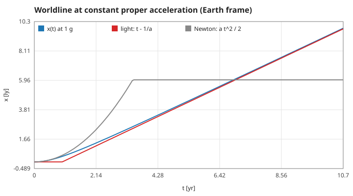
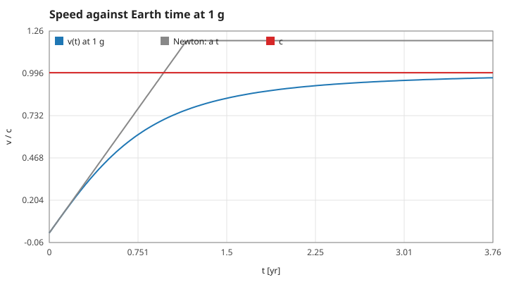
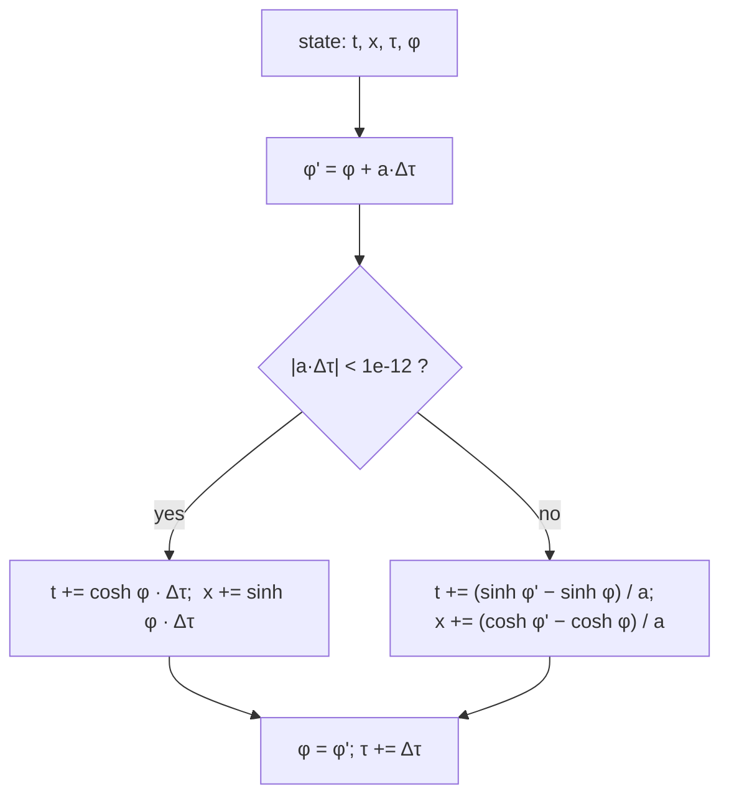
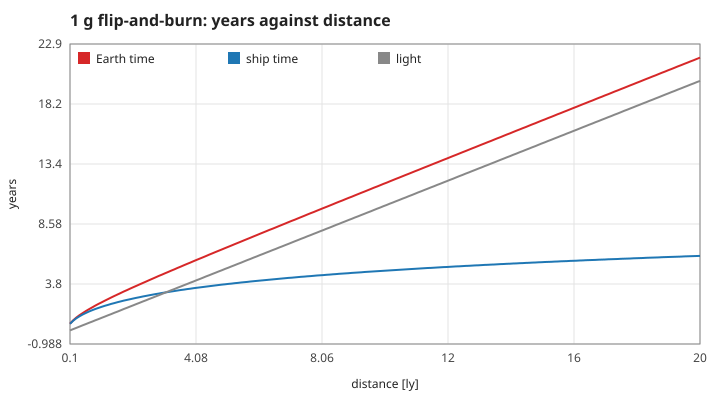

# 2. The accelerating rocket

Constant proper acceleration, the exact step the program uses, and the trip to the star. Units as in page 1. Measured numbers are quoted by their id in [figures/values.md](figures/values.md).

[Back to the index](README.md)

## S07 — Constant proper acceleration is hyperbolic motion

**Statement.** A rocket whose passengers feel a constant acceleration $a$ gains rapidity at the constant rate $d\varphi/d\tau = a$. Starting from rest at the origin,

$$\varphi = a\tau, \qquad v = \tanh a\tau, \qquad t = \frac{\sinh a\tau}{a}, \qquad x = \frac{\cosh a\tau - 1}{a},$$

and the worldline is the hyperbola $(x + 1/a)^2 - t^2 = 1/a^2$ [Born 1909; Misner, Thorne & Wheeler 1973, §6.2; Rindler 2006, §3.7].

**Assumptions and where they break.** The acceleration is the one measured on board (proper acceleration), constant in size. Seen from Earth the coordinate acceleration $d^2x/dt^2 = a/\gamma^3$ fades as the rocket nears $c$. Light emitted from behind $x = -1/a$ at $t = 0$ never catches the rocket (a horizon, 0.97 ly at 1 g).

**Derivation.** In the instantaneous rest frame the velocity gained in $d\tau$ is $a\,d\tau$; combining it with the present velocity adds rapidities (S03), so $d\varphi = a\,d\tau$. Then $dt = \cosh\varphi\,d\tau$ and $dx = \sinh\varphi\,d\tau$ (S04) integrate to the formulas.

**Code.** `rocket_step` in `src/relativity.c`; `ONE_G` = 1.0323 ly/yr² in `src/relativity.h`.

**Tests.** `test_hyperbolic_motion_matches_closed_form` ($t$, $x$ to 1e-9, $v$ to 1e-12) and `test_worldline_is_a_hyperbola` (1e-9) in `tests/test_relativity.c`. Measured over 3 yr on board in 600 steps: off the hyperbola by at most `hyperbola` = 1.8e-13; `after-3yr-x` = 9.77 ly in `after-3yr-t` = 10.70 yr of Earth time; `v-after-1yr` = 0.775; the constant `one-g` agrees with 9.80665 m/s² × one Julian year / c to 5 parts in a million.

## S08 — The step is exact, whatever its size

**Statement.** For a constant $a$ during a step $\Delta\tau$, from rapidity $\varphi$:

$$\varphi' = \varphi + a\Delta\tau, \qquad \Delta t = \frac{\sinh\varphi' - \sinh\varphi}{a}, \qquad \Delta x = \frac{\cosh\varphi' - \cosh\varphi}{a}, \qquad \tau' = \tau + \Delta\tau,$$

and for $a = 0$: $\Delta t = \cosh\varphi\,\Delta\tau$, $\Delta x = \sinh\varphi\,\Delta\tau$. This is the exact solution, not an approximation: one step of 2 yr and 100 000 steps of 0.00002 yr land on the same event, and a thrust that is constant between key presses is integrated without error.

**Assumptions and where they break.** The only numerical error is rounding. The program switches to the coasting formulas when $|a\Delta\tau| < 10^{-12}$; for a tiny but larger $a$ the general formulas divide a rounding error by $a$ (measured below). The game only ever uses $a = 0$ or $\pm 1$ g, far from that region.

**Derivation.** Integrate $dt = \cosh\varphi\,d\tau$, $dx = \sinh\varphi\,d\tau$ with $\varphi(\tau) = \varphi_0 + a\tau$ over the step (S07 from an arbitrary start).

**Code.** `rocket_step` in `src/relativity.c`.

**Tests.** `test_hyperbolic_motion_matches_closed_form`; `test_adapter_is_identical_to_rocket_api` in `tests/test_rider.c`. Measured: step size changes $x$ by `step-size-x` = 8e-12 ly over 2 yr (rounding accumulated over 100 000 steps); accelerate, coast, decelerate equals the three closed forms added (`piecewise-x`, `piecewise-t`, `piecewise-v`); a step forward and the same step backward return to the start (`step-reverse`). With $a = 10^{-9}$ the result differs from the coasting value by `coast-limit` = 3e-8 ly — the rounding error just described.

## S09 — The flip-and-burn trip, and the two clocks

**Statement.** To cover a distance $D$ and stop, accelerate at $a$ for the first half and decelerate at $a$ for the second. Then

$$\tau_{half} = \frac{1}{a}\,\mathrm{acosh}\left(1 + \frac{aD}{2}\right), \qquad \tau = 2\tau_{half}, \qquad t = \frac{2}{a}\sinh a\tau_{half} = \sqrt{D^2 + \frac{4D}{a}},$$

with top speed $\tanh a\tau_{half}$ and top Lorentz factor $1 + aD/2$ at the flip [Rindler 2006, §3.8; Misner, Thorne & Wheeler 1973, ex. 6.3]. For $D = 4.2$ ly at 1 g: 3.527 yr on board, 5.824 yr on Earth, top speed 0.9489.

**Assumptions and where they break.** Instant turn-round of the engine at the midpoint; no fuel is modelled (a real rocket's mass ratio for this trip is enormous). The traveller always ages less than Earth, and Earth's time always exceeds the light-travel time $D$.

**Derivation.** By symmetry each half covers $D/2$: $(\cosh a\tau_{half} - 1)/a = D/2$ gives $\tau_{half}$; the Earth time of each half is $\sinh(a\tau_{half})/a$, and $\sinh^2 = \cosh^2 - 1$ gives the closed form. The asymmetry between the twins is real: the traveller's path through spacetime is not a straight line, and the straight line between two events is the one of longest proper time.

**Code.** `rr_reset` in `src/rider.c` computes `half_tau = acosh(1.0 + ONE_G * DEST / 2.0) / ONE_G`; `headless` in `src/main.c` does the same for `docs/run.csv`.

**Tests.** `test_flip_and_burn_trip` in `tests/test_relativity.c` (arrival within 1e-6 ly, at rest to 1e-9, traveller younger, slower than light); `test_demo_matches_closed_form` in `tests/test_rider.c`. Measured: `trip-distance` = 4.2, `trip-ship-time` = 3.52668, `trip-earth-time` = 5.82360, `trip-top-speed` = 0.94887, `trip-top-gamma` = 3.16783, `trip-end-speed` = 0, and Earth's time is `trip-vs-light` = 1.387 times the light-travel time.

## References

- M. Born, "Die Theorie des starren Elektrons in der Kinematik des Relativitätsprinzips", *Annalen der Physik* 30, 1–56, 1909.
- C. W. Misner, K. S. Thorne, J. A. Wheeler, *Gravitation*, W. H. Freeman, 1973.
- W. Rindler, *Relativity: Special, General, and Cosmological*, 2nd ed., Oxford University Press, 2006.
