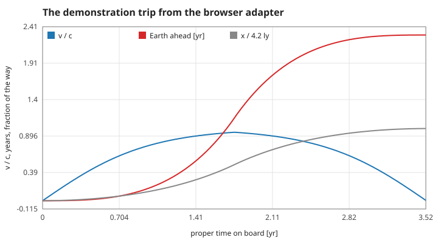
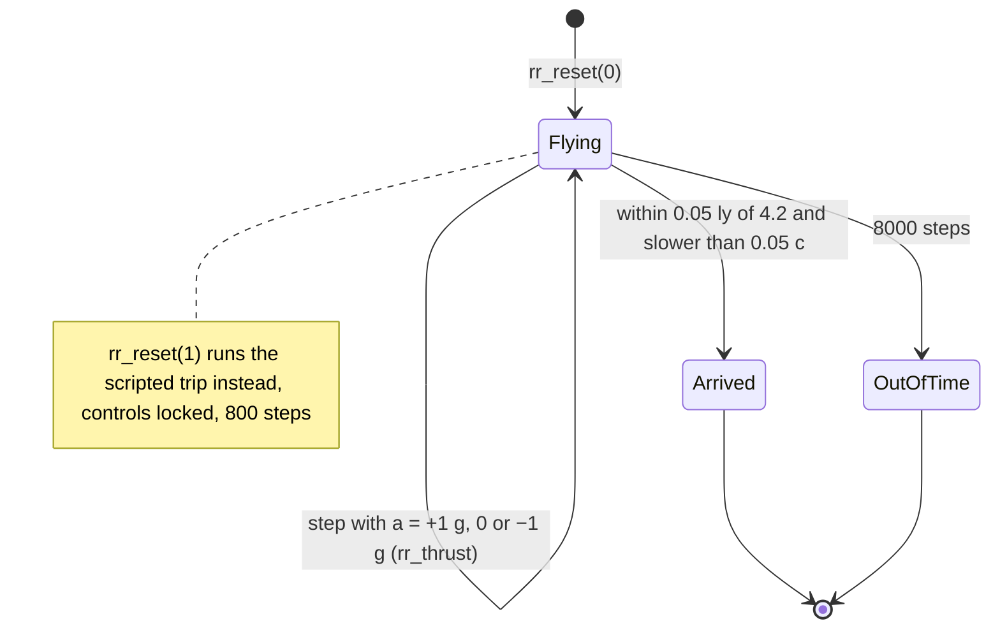
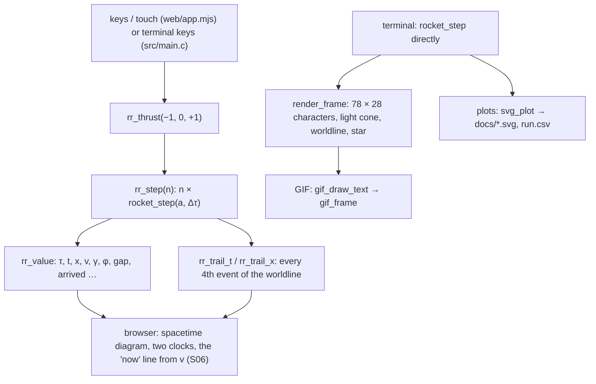

# 3. The program: flying, arriving and drawing

The rules of the browser observatory and the terminal game on top of the model of pages 1 and 2. Measured numbers are quoted by their id in [figures/values.md](figures/values.md).

[Back to the index](README.md)

## S10 — The demonstration: 800 exact steps

**Statement.** The scripted trip divides each half into 400 steps of proper time $\Delta\tau = \tau_{half}/400 = 0.004408$ yr: $+1$ g for steps 0–399, $-1$ g for steps 400–799. Manual flight uses the same $\Delta\tau$. Because each step is exact (S08), the demonstration ends on the closed-form event of S09 to rounding, with no accumulated error.

**Assumptions and where they break.** The controls are locked during the demonstration, and nothing advances after its last step.

**Derivation.** A design rule; 400 steps per half make the drawn worldline smooth, not more accurate.

**Code.** `rr_reset(1)`, `rr_step`, `rr_value` in `src/rider.c`; `RR_DEMO_HALF`, `RR_HALF_TAU`, `RR_DTAU`.

**Tests.** `test_demo_matches_closed_form` and `test_adapter_is_identical_to_rocket_api` in `tests/test_rider.c` (the adapter equals direct calls of `rocket_step` bit for bit). Measured: `demo-steps` = 800, `demo-dtau`, `demo-ship` = 3.52668, `demo-earth` = 5.82360, `demo-max-v` = 0.94887, and thrust asked for after the end takes `demo-locked` = 0 further steps.

## S11 — Manual flight and the arrival rule

**Statement.** The pilot chooses, per step, a proper acceleration of $+1$ g (Accelerate), $-1$ g (Decelerate) or 0 (coast). The rocket **has arrived** when, after at least two steps,

$$|x - 4.2| < 0.05\ \text{ly} \quad\text{and}\quad |v| < 0.05 .$$

One call advances at most 400 steps; a flight ends after 8000 steps (35.3 yr on board) if it has not arrived.

**Assumptions and where they break.** The tolerance is a game rule: at 0.05 c the rocket is still moving at 15 000 km/s. Rapidity is unbounded, so nothing in the model prevents flying past the star; the step limit ends such flights.

**Derivation.** A design rule; the same thresholds as the terminal game.

**Code.** `rr_thrust`, `rr_step`, the static helpers `at_rest_on_star` and `finished` in `src/rider.c`; `RR_MAX_STEPS`, `RR_ARRIVED`, `RR_DONE`.

**Tests.** `test_manual_controls` in `tests/test_rider.c`. Measured: 100 steps of Accelerate add a rapidity of `manual-rapidity` = 0.455 = 1 g × 100 Δτ; coasting changes it by `manual-coast` = 0; 100 steps of Decelerate bring the velocity back to `manual-stop` = 0; one call asking for 5000 steps takes `manual-clamp` = 400; a rocket that never leaves stops at `manual-limit` = 8000 steps without arriving.

## S12 — The clock gap: who is older

**Statement.** The gauge "Earth ahead" shows $t - \tau$: Earth-frame time of the rocket's present event minus the proper time on board. On arrival at rest it is the unambiguous age difference of the twins, 2.297 yr for the 4.2 ly trip at 1 g.

**Assumptions and where they break.** During the flight $t$ is "now on Earth" by Earth's simultaneity only (S06); the number becomes frame-independent when the two clocks are at rest relative to each other again. It never decreases, since $dt/d\tau = \gamma \ge 1$.

**Derivation.** $t - \tau = \int(\gamma - 1)\,d\tau$ along the worldline (S04).

**Code.** `rr_value(RR_GAP)` in `src/rider.c`.

**Tests.** `test_demo_matches_closed_form` in `tests/test_rider.c`. Measured: `demo-gap` = 2.29692 yr, equal to the difference of the two closed forms of S09 to 4 parts in 10¹⁴.

## S13 — The worldline on the screen

**Statement.** Both displays draw the Earth frame: $x$ to the right, $t$ upwards, light at 45°. The past worldline is the list of events the model actually passed through — the browser records every fourth step — and every mark is placed at an event computed in C. JavaScript and the terminal renderer draw and collect input only.

**Assumptions and where they break.** The terminal grid has 0.25 ly per column and 0.5 yr per row, so its light cone is drawn with characters rather than at a true 45°. The artwork (background, portraits) is decoration and not a measurement.

**Derivation.** A design rule: one model, three displays.

**Code.** `rr_trail_t`, `rr_trail_x`, `rr_value` in `src/rider.c`; `render_frame` in `src/render.c`; `gif_open`, `gif_frame`, `gif_close`, `gif_text_size`, `gif_draw_text` in `src/gif.c`; `svg_plot` in `src/svg.c`.

**Tests.** `test_interval_and_trail` in `tests/test_rider.c`; `test_render_fits_the_screen` in `tests/test_relativity.c`; `tests/test_gif.c`. Measured: the demonstration records `demo-trail` = 201 points, the last at `demo-trail-end` = 4.2 ly and `demo-trail-end-t` = 5.8236 yr.

## References

- The rules are this repository's: `src/rider.c`, `src/main.c`. The model they act on is pages 1 and 2.
