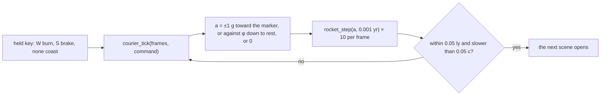
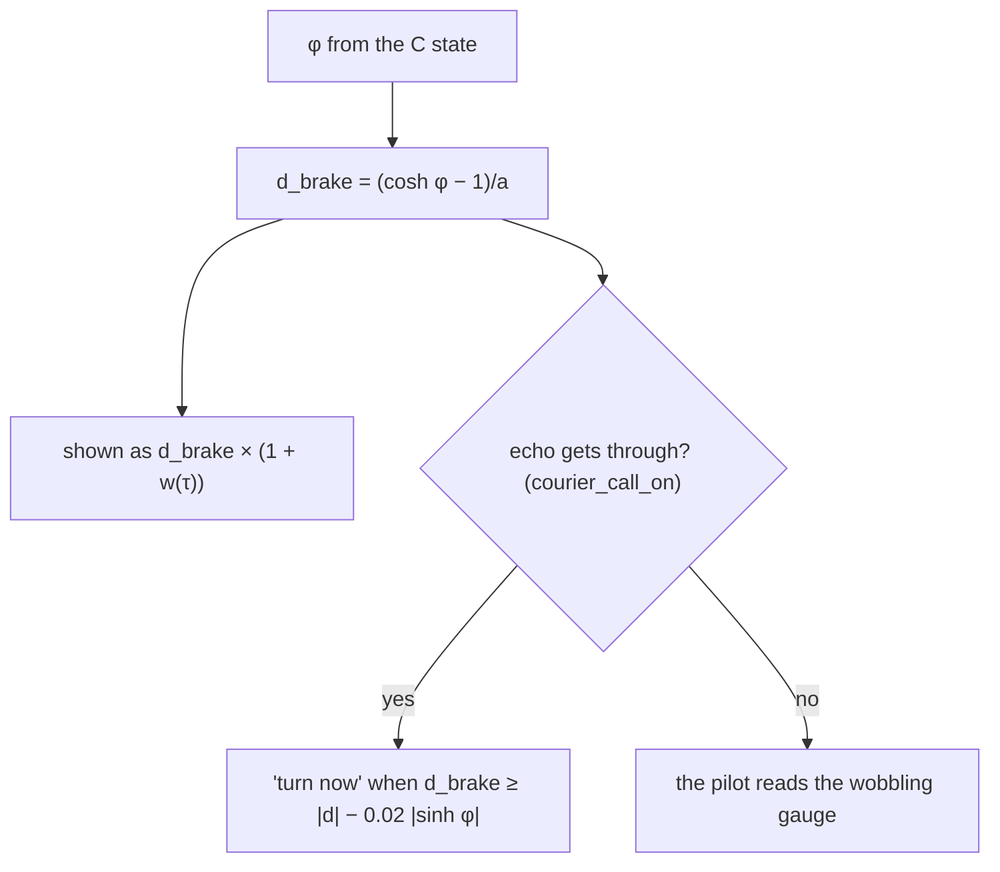
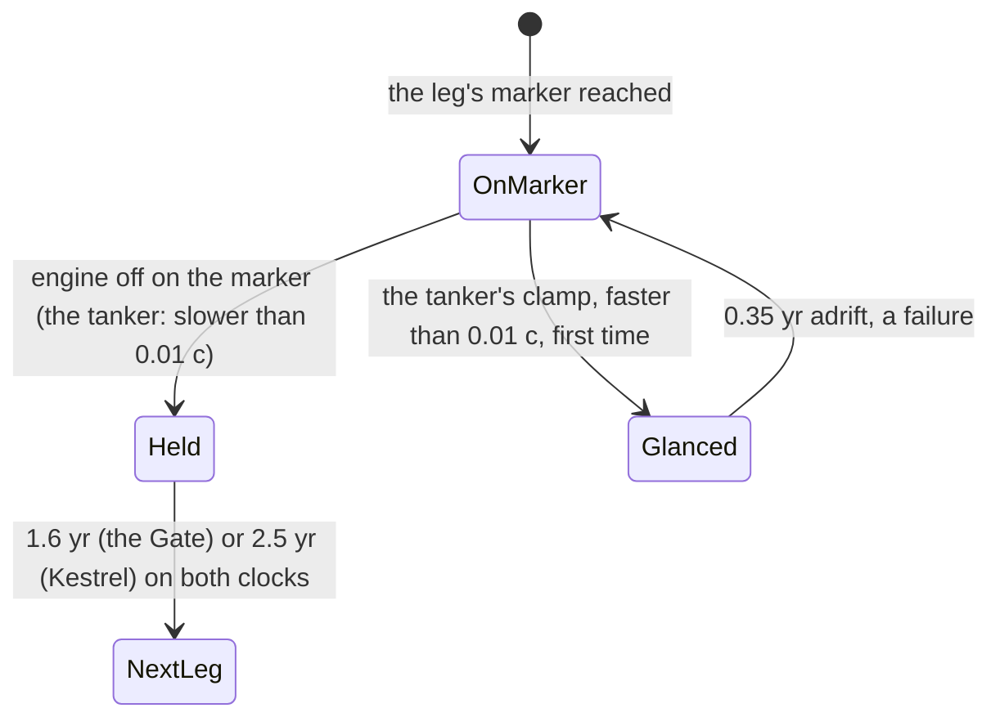
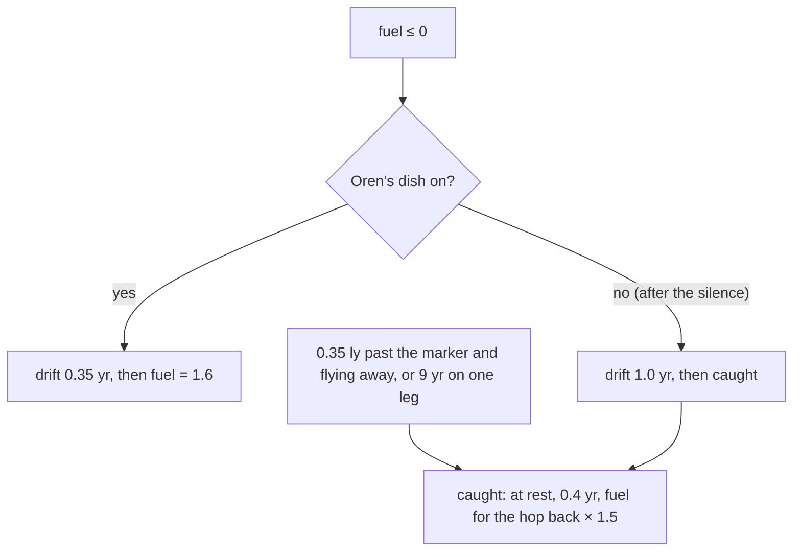
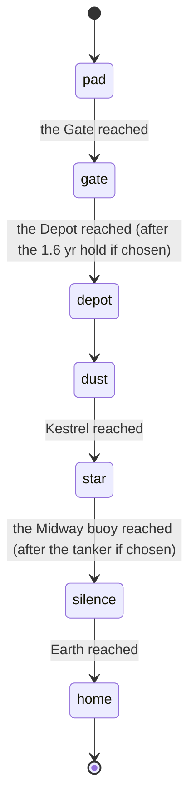

# 4. The Long Echo: the story trip on the same model

The story mode flies Vela out to Kestrel Post at the star and home again in five legs. It is a game layer on top of pages 1–3: it never moves the rocket except through the exact step of S08, and every story beat changes a game number (the tank, a hold, the readout, a leak, a rescue), never the physics. The code is `src/courier.c`; the words are in `web/story.mjs`.

[Back to the index](README.md)

## S14 — Burn, Brake, Coast: the only ways the story moves the rocket

**Statement.** Each frame is ten substeps of $\Delta\tau = 0.001$ yr. In each substep the rocket takes one exact step `rocket_step(a, Δτ)` with

- Burn: $a = \pm 1$ g, the sign pointing at the current leg's marker;
- Brake: $a = -\operatorname{sign}(\varphi)\cdot 1$ g, cut short in the substep that reaches $\varphi = 0$, so braking ends at rest exactly;
- Coast, a dry tank, a drifting rocket or a hold: $a = 0$.

A leg ends when the rocket is within 0.05 ly of the marker and slower than 0.05 c (the arrival rule of S11). The markers are Earth (0), the Gate (0.8 ly), the Depot (2.0 ly, the Midway buoy on the way home) and Kestrel Post at the star (4.2 ly).

**Assumptions and where they break.** A partial brake in one substep is a constant acceleration smaller than 1 g for that substep: still hyperbolic motion, still exact. A tug's rescue (S17) is the one place where the story stops the rocket by itself; it is counted as a failure.

**Derivation.** Rapidity is additive under constant proper acceleration (S07), so a substep with $|a|\,\Delta\tau \ge |\varphi|$ can be shortened to land on $\varphi = 0$.

**Code.** `courier_tick` in `src/courier.c` (it calls `rocket_step` from `src/relativity.c` and nothing else to move the rocket).

**Tests.** `[physics]` in `tests/test_courier.c`: 30 frames of Burn equal 300 calls of `rocket_step` at 1 g bit for bit, with every story number on and with every one off, and match $x = (\cosh a\tau - 1)/a$; Coast keeps $v$; Brake ends at $\varphi = 0$ exactly. Every frame of every test flight advances the ship clock by 0.01 yr and the Earth clock by at least as much.

## S15 — The brake distance, the readout and Oren's call

**Statement.** From rapidity $\varphi$ at proper acceleration $a$ the rocket needs, in the Earth frame,

$$d_{brake} = \frac{\cosh\varphi - 1}{a}$$

to come to rest. The panel shows it with a relative wobble $w(\tau)$, a fixed smooth function of the ship clock: amplitude 0.6 with nobody ranging the rocket, 0.06 while Oren's dish echoes it, plus 0.1 in the dust (0.025 if calibrated at the Gate). While his echo gets through he calls "turn now" once $d_{brake} \ge |d| - 0.02\,|\sinh\varphi|$, i.e. two frames of travel before the brake distance reaches the distance left $|d|$.

**Assumptions and where they break.** In the story Oren's call arrives at once; a real call from Earth would be years late. The wobble is a game rule standing in for an uncertain range measurement, not a physical effect.

**Derivation.** Braking from $\varphi$ to 0 at constant $a$ is the hyperbolic motion of S07 run backwards: $\Delta x = (\cosh\varphi - 1)/a$. In one frame of 0.01 yr of ship time the rocket covers $\sinh\varphi \cdot 0.01$ in the Earth frame.

**Code.** `courier_brake_distance`, `courier_wobble`, `courier_call_on` and `courier_cue` in `src/courier.c`.

**Tests.** `[mech] pad` in `tests/test_courier.c`: with the pad's numbers the wobble is ×0.10 of the readout without them, and the call comes while $|d| - 0.02\sinh\varphi \le d_{brake} < |d|$.

## S16 — Holds on a marker: a light round trip, and the tanker

**Statement.** Two answers make the rocket hold at rest on a marker while both clocks run:

- at the Gate, the calibration needs a pulse to Earth and back, $2 \times 0.8\ \text{ly} / c = 1.6$ yr;
- at Kestrel, the tanker needs 2.5 yr, and its clamp takes only a rocket slower than 0.01 c (a faster one glances off once: a failure).

At rest $dt/d\tau = \gamma = 1$, so a hold adds the same years to Vela's clock and to Oren's.

**Assumptions and where they break.** The light round trip assumes Earth at rest at $x = 0$ and the Gate at rest at 0.8 ly in the same frame, which is the frame of the whole diagram.

**Derivation.** Light covers 0.8 ly in 0.8 yr each way at $c = 1$ (S01).

**Code.** `courier_calibration_hold` and `courier_hold_need` in `src/courier.c`.

**Tests.** `[mech] gate` and `[mech] star` in `tests/test_courier.c`: the calibration hold is 1.6 yr and both clocks advance by at least that much; at rest the tanker clamps and adds 1.8, at 0.02 c it glances off once.

## S17 — Fuel is rapidity; leaks and rescues

**Statement.** The tank holds rapidity: burning at $|a|$ for $\Delta\tau$ costs $|a|\Delta\tau$, so a clean flip-and-burn from rest over $d$ costs $2\,\mathrm{acosh}(1 + a d/2)$ (S09). In the dust the tank also leaks 0.6 per ship year. Failures are counted, never fatal:

- a dry tank while the echo is on: the engine is dead for 0.35 yr while the rocket coasts, then a drone fills the tank to 1.6;
- after the silence: the rocket coasts 1.0 yr until Kestrel's tug finds it and catches it;
- 0.35 ly past the marker (or behind the leg's start) and still flying away, or 9 ship years on one leg: a tug catches it.

A catch brings the rocket to rest where it is and stays 0.4 yr beside it ($a = 0$, so both clocks gain 0.4 yr), then fills the tank to 1.5 × what the hop back to the marker needs.

**Assumptions and where they break.** The tug's braking is not simulated; it is the one discontinuity in $\varphi$ in the story, and it is always counted as a failure.

**Derivation.** For an ideal rocket the change in rapidity is the fuel spent in these units, and $\int |a|\,d\tau = |\Delta\varphi|$ along each burn.

**Code.** `courier_leak`, `courier_tick` and the static helpers `catch_rocket`, `rescue` and `hop_need` in `src/courier.c`.

**Tests.** `[mech] dust` (0.6 per ship year, burning or not) and `[mech] silence` (a dry tank drifts 1.0 yr after the silence, 0.35 yr before it) in `tests/test_courier.c`.

## S18 — Scenes, choices, heavy scenes and endings

**Statement.** Scenes open only at fixed progress points — the pad, and the end of each leg — so every seed meets them in the same order: pad, gate, depot, dust, star, silence, home. Two scenes are choices (wait at the Gate or go; wait for Kestrel's tanker or turn for home), and the second picks the ending. The dust, the echo at Kestrel and the silence are heavy: they open with no "marker reached" banner and none is raised after them.

**Assumptions and where they break.** The bench pilot (tests/courier_policy.h) is test code, not a rule of the game: it reads the panel like a person, turns a little early or late, reacts a few frames late, and makes careful short hops after a miss.

**Derivation.** A design rule; the effects each scene changes are bits (`CE_PAD`, `CE_CALIB`, `CE_CACHE`, `CE_DUST`, `CE_TANKER`, `CE_SILENCE`) so the bench can remove them one at a time.

**Code.** `courier_init`, `courier_answer`, `courier_options`, `courier_heavy`, `courier_ending` and `courier_value` in `src/courier.c`; the browser bridge `src/courier_web.c` only forwards to them.

**Tests.** `[order]`, `[quiet] dust`, `[quiet] star`, `[quiet] silence` and `[choice]` in `tests/test_courier.c`; `make story` writes docs/narrative/play-order.json, ablation.json and tension.json and `make test` re-runs rows of them and requires them verbatim.
