# 5. Orbits around a black hole (general relativity)

Free fall near a non-rotating, uncharged mass: the Schwarzschild solution, its two conserved quantities, the orbits and light rays they allow, the clocks along them, and the integrator the program uses. Measured numbers are quoted by their id in [figures/values.md](figures/values.md).

Units: geometric, $G = c = 1$ and the mass $M = 1$. Lengths and times are in units of $M$; for the Sun $M$ = 1476.6 m = 4.93 microseconds. This page is separate from the 1+1 dimensional rocket of pages 1–4: those use years and light-years and flat spacetime, and nothing here changes them.

[Back to the index](README.md)

## S19 — Geodesics of the Schwarzschild metric: the energy E and the angular momentum L are conserved

**Statement.** Outside a spherical mass $M$ spacetime is

$$ds^2 = -\left(1 - \frac{2M}{r}\right)dt^2 + \frac{dr^2}{1 - 2M/r} + r^2\,d\Omega^2,$$

where $t$ is the time of a clock far away and $r$ the circumference of a circle divided by $2\pi$ [Schwarzschild 1916; Misner, Thorne & Wheeler 1973, §25]. A freely falling body moves on a geodesic. In the plane $\theta = \pi/2$ two quantities per unit mass are constant,

$$E = \left(1 - \frac{2M}{r}\right)\frac{dt}{d\tau}, \qquad L = r^2\,\frac{d\varphi}{d\tau},$$

so the far-away clock and the angle follow from $r$ alone: $dt/d\tau = E/(1 - 2M/r)$, $d\varphi/d\tau = L/r^2$.

**Assumptions and where they break.** The mass is spherical, not rotating, not charged, and the orbiting body is a test particle (no back-reaction, no gravitational waves, no tides). The coordinates fail at the horizon $r = 2M$ ($dt/d\tau$ diverges there although nothing local happens); the program stops a geodesic at $r = 2M(1 + 1\times10^{-3})$. The plane is the equatorial one; by symmetry every orbit lies in some plane.

**Derivation.** The metric does not depend on $t$ or $\varphi$, so their conjugate momenta $p_t = -E$ and $p_\varphi = L$ are constant along a geodesic (Killing vectors $\partial_t$, $\partial_\varphi$). Lowering the indices of $dx^\mu/d\tau$ with the metric gives the two formulas.

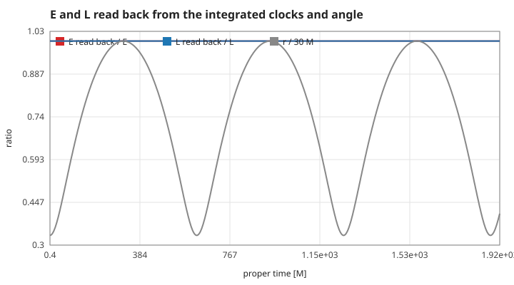

**Code.** `geo_init`, `geo_rate` and the kick of `geo_step` in `src/schwarzschild.c` (the angle advances by $L/r^2$, the clock by `geo_rate`); `geo_from_apsides` builds the orbit with given turning points.

**Tests.** `test_conserved_quantities` in `tests/test_schwarzschild.c`: $E$ and $L$ from finite differences of $t$ and $\varphi$ within 2e-3 over 100 laps. Measured: `geo-e`, `geo-l` (the orbit built from its turning points has the $E$ and $L$ of the closed form to rounding); the midpoint differences agree to `geo-e-fd` = 1.1e-6 and `geo-l-fd` = 9.1e-6 (their own second-order error).

## S20 — The effective potential decides where the body can go

**Statement.** With $s$ the proper time (massive body) or an affine parameter (light),

$$\frac{1}{2}\left(\frac{dr}{ds}\right)^2 + V(r) = H, \qquad V(r) = \frac{1}{2}\left(1 - \frac{2M}{r}\right)\left(\kappa + \frac{L^2}{r^2}\right), \qquad H = \frac{E^2}{2},$$

with $\kappa = 1$ for a body and $\kappa = 0$ for light. The body moves where $2V(r) \le E^2$ and turns where they are equal. For a body, $2V = 1 - 2M/r + L^2/r^2 - 2ML^2/r^3$: Newton's effective potential plus the last term, which pulls in at small $r$ and makes the barrier finite.

**Assumptions and where they break.** As S19. For Newton's comparison the program uses $V_N = -M/r + L^2/(2r^2)$ with $H$ the specific energy and $s = t$.

**Derivation.** The normalisation $g_{\mu\nu}\,\dot x^\mu \dot x^\nu = -\kappa$ with S19 substituted for $\dot t$ and $\dot\varphi$ gives $\dot r^2 = E^2 - (1 - 2M/r)(\kappa + L^2/r^2)$. Differentiating once gives the radial equation $\ddot r = -V'(r)$, which is what the program integrates (no square root, so turning points need no special care).

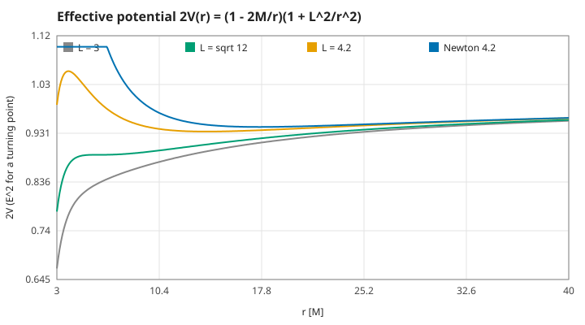

**Code.** `geo_potential` and `geo_force` ($-V'$) in `src/schwarzschild.c`; the browser draws `so_curve` and `so_ncurve` from `src/orbit.c`.

**Tests.** `test_potential_and_force` in `tests/test_schwarzschild.c`. Measured: `potential-force` (the force against central differences of $V$), `potential-extra` (the extra term $-2ML^2/r^3$ at $r = 9$, $L = 4$), `potential-level` ($E^2$ of the browser's default start).

## S21 — Circular orbits, and Kepler's third law in far-away time

**Statement.** Circular orbits sit where $V'(r) = 0$:

$$L^2 = \frac{Mr^2}{r - 3M}, \qquad r_\pm = \frac{L^2}{2M}\left(1 \pm \sqrt{1 - \frac{12M^2}{L^2}}\right), \qquad E = \frac{1 - 2M/r}{\sqrt{1 - 3M/r}},$$

with $r_+$ stable (a minimum of $V$) and $r_-$ unstable (a maximum). Measured with the far-away clock the angular speed is exactly Newton's: $d\varphi/dt = \sqrt{M/r^3}$.

**Assumptions and where they break.** Circular orbits exist only outside $3M$ ($L^2 \to \infty$ there); between $3M$ and $6M$ they are unstable (S22).

**Derivation.** $V'(r) = M/r^2 - L^2/r^3 + 3ML^2/r^4 = 0$ is a quadratic in $1/r$. Then $d\varphi/dt = (L/r^2)(1 - 2M/r)/E$, and inserting $L$ and $E$ the factors of $\sqrt{1 - 3M/r}$ and $(1 - 2M/r)$ cancel.

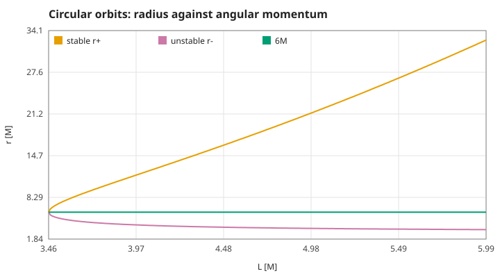

**Code.** `geo_circular_L`, `geo_circular_radius`, `geo_unstable_radius` in `src/schwarzschild.c`.

**Tests.** `test_circular_orbits` in `tests/test_schwarzschild.c` (radius within 1e-8, $d\varphi/dt$ within 1e-10, $E$ within 1e-12, at 7, 18 and 29 M). Measured: `circular-l`, `circular-radius`, `circular-stays`, `circular-kepler` (1.8e-13 over ten laps), `circular-energy`.

## S22 — No stable circular orbit inside 6M

**Statement.** The innermost stable circular orbit (ISCO) is at $r = 6M$, with $L = \sqrt{12}\,M$. A circular orbit outside it, nudged, oscillates about it; inside it, the smallest nudge either falls in or flies out.

**Assumptions and where they break.** As S19. Real accretion discs end near the ISCO; spin moves it (from $M$ to $9M$ for a rotating hole), which this model does not include.

**Derivation.** Stability needs $V''(r) > 0$ at the circle. The two circular radii $r_\pm$ of S21 are real only for $L^2 \ge 12M^2$ and merge at $r = 6M$ when $L^2 = 12M^2$; there $V' = V'' = 0$. Equivalently $L^2(r) = Mr^2/(r - 3M)$ is least at $r = 6M$. A nudge of $dr/d\tau = \delta$ outside oscillates with amplitude $\delta/\sqrt{V''(r)}$.

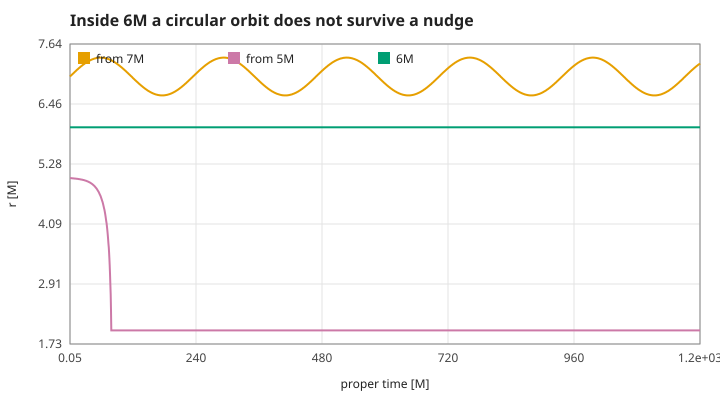

**Code.** `geo_isco` and `geo_circular_radius` in `src/schwarzschild.c`.

**Tests.** `test_isco` in `tests/test_schwarzschild.c`. Measured: `isco-scan` (least $L$ at 6M by scanning), `isco-l`, `isco-flat` ($V''$ at 6M), `isco-outside` (the width of the oscillation at 7M against $2\delta/\sqrt{V''}$, within 0.4%), `isco-inside`.

## S23 — Light: the photon sphere at 3M and the critical impact parameter

**Statement.** For light ($\kappa = 0$, $E = 1$, impact parameter $b = L/E$) the potential $V = (1 - 2M/r)L^2/(2r^2)$ peaks at $r = 3M$, the photon sphere, where light can circle (unstably). Light coming from far away is captured if $b < b_c = 3\sqrt{3}\,M \approx 5.196\,M$ and escapes otherwise; just above $b_c$ it winds round the hole before leaving.

**Assumptions and where they break.** Geometric optics (wavelength much shorter than $M$); the light is not absorbed by anything.

**Derivation.** $V'(r) = 0$ gives $r = 3M$. Light from infinity has $\dot r^2 = 1 - (1 - 2M/r)b^2/r^2$; it reaches the hole if this stays positive at the peak, $1/b^2 > 1/27M^2$.

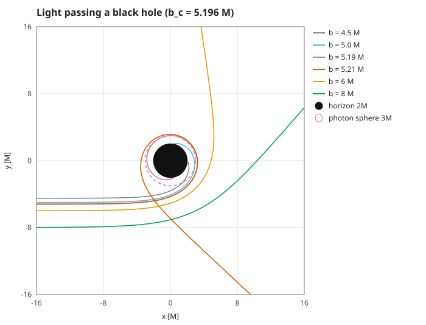

**Code.** `geo_photon_sphere` and `geo_critical_b` in `src/schwarzschild.c`; light is `GEO_LIGHT` in the same `geo_step`.

**Tests.** `test_light` in `tests/test_schwarzschild.c`: captured at $0.999\,b_c$, escapes at $1.001\,b_c$ after more than $2\pi$. Measured: `photon-peak`, `photon-bcrit`, `light-below`, `light-above` (9.39 rad swept).

## S24 — The bending of light: 4M/b far away

**Statement.** Light passing at impact parameter $b \gg M$ is deflected by

$$\delta\varphi = \frac{4M}{b} + \frac{15\pi}{4}\frac{M^2}{b^2} + O\!\left(\frac{M^3}{b^3}\right),$$

twice Newton's value for a particle at the speed of light. At the rim of the Sun this is 1.75 arcseconds [Einstein 1916; Dyson, Eddington & Davidson 1920].

**Assumptions and where they break.** The series needs $b \gg M$; near $b_c$ the deflection grows without bound (S23). The exact deflection is the quadrature below, which the program evaluates and against which the integrator is checked.

**Derivation.** With $u = 1/r$, $(du/d\varphi)^2 = 1/b^2 - u^2 + 2Mu^3$. The angle swept from infinity to the closest approach $u_0$ and back is $2\int_0^{u_0} du/\sqrt{\cdots}$; minus $\pi$ it is the deflection. Expanding in $M/b$ gives the series. The program removes the inverse square root at $u_0$ with $u = u_0 - (u_0 - u_a)(1 - \sin\theta)$ and uses 5-point Gauss–Legendre on 2000 panels, with the cubic factored through its roots so that it stays accurate next to them.

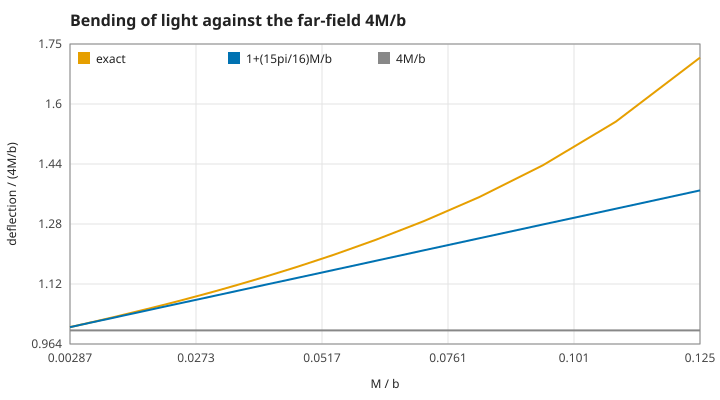

**Code.** `geo_swept_angle` (quadrature) and `geo_deflection_weak` in `src/schwarzschild.c`.

**Tests.** `test_light` in `tests/test_schwarzschild.c`: the integrated ray against the quadrature with the same limits within 1e-8, and the deflection against both terms for $b$ = 30 to 750 M. Measured: `deflection-1000`, `deflection-1000-two` (the two-term series is 1e-5 off in relative terms at $b$ = 1000 M), `deflection-6` (near the photon sphere the formula is useless), `deflection-sun`, `deflection-quadrature`.

## S25 — The orbit turns: periapsis precession

**Statement.** A bound orbit between periapsis $r_p$ and apoapsis $r_a$ does not close: from one periapsis to the next the angle grows by $2\pi + \Delta\varphi$ with, exactly,

$$2\pi + \Delta\varphi = \frac{4K(k)}{\sqrt{2M(u_3 - u_1)}}, \qquad k^2 = \frac{u_2 - u_1}{u_3 - u_1},$$

where $u_1 = 1/r_a$, $u_2 = 1/r_p$, $u_3 = 1/(2M) - u_1 - u_2$ and $K$ is the complete elliptic integral of the first kind. Far from the hole, with $a$ the semi-major axis, $e$ the eccentricity and $p = a(1 - e^2)$,

$$\Delta\varphi \approx \frac{6\pi M}{p}\left(1 + \frac{18 + e^2}{4}\frac{M}{p}\right).$$

For Mercury the first term is 43 arcseconds per century, the part of its observed turn that Newton's theory leaves unexplained [Einstein 1915].

**Assumptions and where they break.** As S19 (no other planets, no oblateness of the Sun). $r_p$ must lie outside the unstable circular orbit for the same $L$ ($u_3 > u_2$). $a$ and $e$ are defined from the Schwarzschild $r$ of the turning points.

**Derivation.** For a body $(du/d\varphi)^2 = 2Mu^3 - u^2 + 2Mu/L^2 + (E^2 - 1)/L^2 = 2M(u - u_1)(u - u_2)(u - u_3)$; comparing coefficients gives $u_1 + u_2 + u_3 = 1/(2M)$, $L^2$ and $E$ from the turning points. The angle from $u_1$ to $u_2$ is an elliptic integral; the standard reduction gives $2K(k)/\sqrt{2M(u_3 - u_1)}$, doubled for a full lap. Expanding in $M/p$ gives the series.

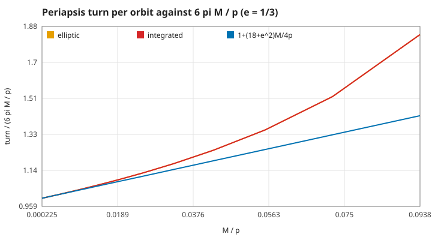

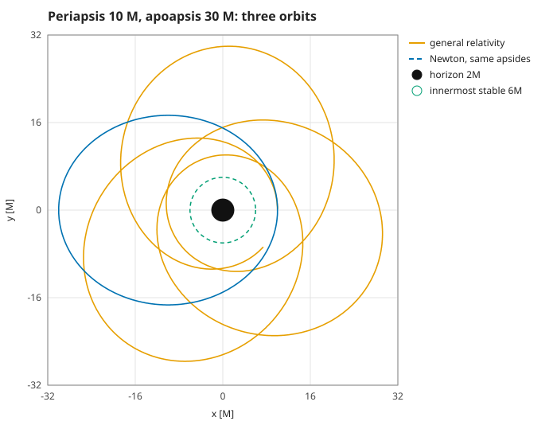

**Code.** `geo_precession_exact`, `geo_precession_weak`, `geo_from_apsides`, `geo_apsides` (the turning points: the cubic solved in closed form) and `geo_apsis_step` (the exact moment of periapsis: a secant on the fraction of the step) in `src/schwarzschild.c`; the browser's measured turn per lap is `SO_PREC` in `src/orbit.c`.

**Tests.** `test_precession` in `tests/test_schwarzschild.c`: quadrature and integration against the elliptic integral within 1e-9 for $r_p$ = 10 to 2430 M; the first-order formula's relative error falls below $\tfrac{8}{p}$, the two-term one's below $\tfrac{30}{p^2}$. Measured: `precession-integrated` (3e-11 rad), `precession-10-30`, `precession-weak-10-30` (in the strong field the formula is 32% short), `precession-first-order`, `precession-mercury`.

## S26 — Clocks near the hole run slow

**Statement.** Against the far-away clock $t$, a clock held at rest at $r$ runs at $d\tau/dt = \sqrt{1 - 2M/r}$; a clock on the circular orbit at $r$ runs at $d\tau/dt = \sqrt{1 - 3M/r}$. The second is the first times $1/\gamma$ of the orbit's speed $v = \sqrt{M/(r - 2M)}$ as measured by a static observer there: gravitational and special-relativistic time dilation multiply.

**Assumptions and where they break.** The static clock needs a rocket to hold it; inside $2M$ no clock can be held at rest. On the Earth's surface the first effect is 7e-10 (the GPS satellites correct for it).

**Derivation.** For $dr = d\varphi = 0$, $d\tau^2 = (1 - 2M/r)dt^2$. On the circle, $d\tau/dt = (1 - 2M/r)/E$ with $E$ from S21. The static observer's proper distance along the orbit per proper time is $r\,d\varphi/(\sqrt{1 - 2M/r}\,dt)$, which is $v$; then $\sqrt{1 - 2M/r}\sqrt{1 - v^2} = \sqrt{1 - 3M/r}$.

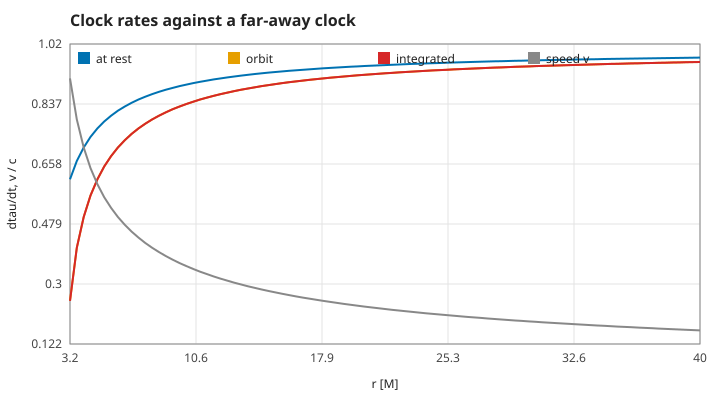

**Code.** `geo_static_rate`, `geo_circular_rate`, `geo_local_speed` and `geo_rate` in `src/schwarzschild.c`; the split uses `lorentz_gamma` of page 1 (`src/relativity.c`).

**Tests.** `test_circular_orbits` in `tests/test_schwarzschild.c` (the integrated $\tau/t$ against static rate over $\gamma$, within 1e-10). Measured: `clock-split` (6e-14 over $r$ = 3.2 to 40 M), `clock-static-6`, `clock-orbit-6`, `clock-local-6` (half the speed of light at the ISCO), `clock-earth`.

## S27 — Falling in takes a finite proper time, and forever on the far-away clock

**Statement.** Dropped from rest at $R$ (with $L = 0$), a body reaches radius $r$ after the proper time

$$\tau(r) = \sqrt{\frac{R^3}{2M}}\left(\sqrt{\frac{r}{R}\left(1 - \frac{r}{R}\right)} + \arccos\sqrt{\frac{r}{R}}\right)$$

(a cycloid, the same formula as Newton's fall with $t$ replaced by $\tau$). It crosses $2M$ in finite proper time, while $dt/d\tau = E/(1 - 2M/r)$ grows without bound: the far-away clock never sees it cross.

**Assumptions and where they break.** As S19. The program stops at $r = 2M(1 + 1\times10^{-3})$, where the coordinates stop being useful.

**Derivation.** With $L = 0$ and $E^2 = 1 - 2M/R$, $\dot r^2 = 2M/r - 2M/R$; substituting $r = R\cos^2(\eta/2)$ integrates it.

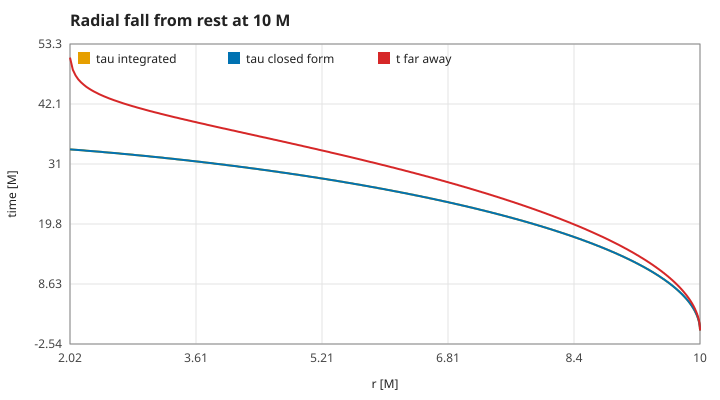

**Code.** `geo_fall_time` and the capture in `geo_step` in `src/schwarzschild.c`.

**Tests.** `test_fall` in `tests/test_schwarzschild.c` (to 3M within 1e-6; captured; $dt/d\tau$ above 500 at the stop). Measured: `fall-3`, `fall-horizon`, `fall-rate` (1318 at 2.002M).

## S28 — The integrator: a fourth-order symplectic step, energy error bounded

**Statement.** The program advances $(r, p_r)$ with $p_r = dr/ds$ by the kick–drift–kick leapfrog composed three times with the weights $w_1 = 1/(2 - 2^{1/3})$, $w_0 = -2^{1/3}/(2 - 2^{1/3})$, $w_1$ [Yoshida 1990]. In each kick $r$ is fixed, so $p_r$, $\varphi$ and $t$ advance exactly; in each drift $p_r$ is fixed, so $r$ advances exactly. The step is symplectic and time-reversible, its error is $O(h^4)$, and the error of $H$ stays bounded over any number of laps instead of drifting.

**Assumptions and where they break.** The step must resolve the periapsis (the program uses $2\pi r_p^{3/2}/600$ in the browser). Near the horizon $dt/ds$ is stiff and the far-away clock loses accuracy first; the program stops there (S27). The plain leapfrog is second order and is kept only for comparison.

**Derivation.** $H = p_r^2/2 + V(r)$ splits into a kinetic part and a part depending on $r$ alone, each solved exactly; a symmetric composition of exact flows is symplectic and of second order, and Yoshida's three-stage symmetric composition cancels the third-order error terms. The angle and the clock are quadratures along $r(s)$ advanced inside the same kicks, so they inherit the fourth order.

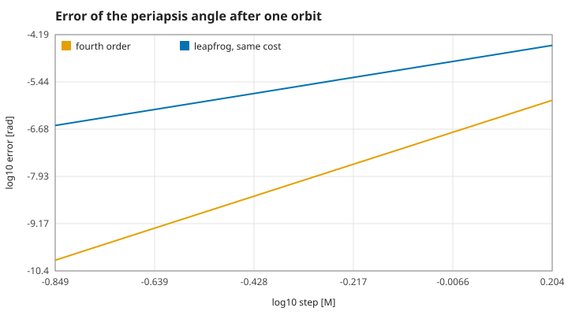

```mermaid
flowchart LR
    A["r, p_r, φ, t"] --> B["leapfrog(w1·h)"] --> C["leapfrog(w0·h)"] --> D["leapfrog(w1·h)"] --> E["r', p_r', φ', t'"]
    subgraph leapfrog["leapfrog(c): kick, drift, kick"]
    K1["kick c/2: p_r += F(r) dt; φ += L/r² dt; t += E/(1 − 2M/r) dt"] --> D1["drift c: r += p_r dt; stop if r ≤ 2M(1 + 1e-3)"] --> K2["kick c/2"]
    end
```

**Code.** `geo_step` and `geo_leapfrog` in `src/schwarzschild.c`.

**Tests.** `test_order` (halving the step divides the error by $2^{3.7..4.3}$; leapfrog $2^{1.7..2.3}$) and `test_conserved_quantities` (energy error below 1e-10 over 100 laps) in `tests/test_schwarzschild.c`. Measured: `order-fourth`, `order-second`, `geo-energy-100` (1.3e-11).

## S29 — Far from the hole the orbit becomes Newton's ellipse

**Statement.** As $M/r \to 0$ the relativistic orbit with given turning points tends to Newton's ellipse: the turn per lap goes to 0, the period in far-away time to Kepler's $2\pi a^{3/2}/\sqrt{M}$, and $L$ to Newton's $\sqrt{2Mr_pr_a/(r_p + r_a)}$. The browser draws Newton's orbit from the same start beside the relativistic one, and for light the straight line with the same $b$.

**Assumptions and where they break.** The comparison is only meaningful at $r \gg M$; near the hole Newton's orbit misses the plunge (S22) and the photon sphere (S23) entirely.

**Derivation.** $2V = 1 - 2M/r + L^2/r^2 - 2ML^2/r^3$: the last term is smaller than the others by $M/r$; dropping it gives Newton's equations, with $\tau \approx t$ to the same order.

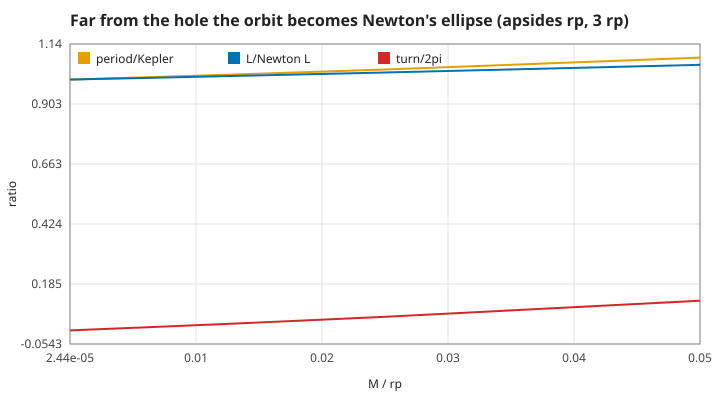

**Code.** `GEO_NEWTON` in `geo_potential`, `geo_force`, `geo_rate` and `geo_from_apsides` in `src/schwarzschild.c`.

**Tests.** `test_newton_limit` (the period ratio approaches 1 monotonically, off by less than $\tfrac{10M}{r_p}$) and the Newton checks in `test_precession` (closes within 1e-9 rad, period $2\pi a^{3/2}$) in `tests/test_schwarzschild.c`. Measured: `newton-closes`, `newton-period`, `newton-limit`.

## S30 — The black-hole experiment in the browser

**Statement.** The browser's black-hole panel shows one geodesic of this page and its Newtonian twin, both computed in C (`src/orbit.c` compiled to WebAssembly). A particle starts at rest radially at $r_0$ (a turning point) with angular momentum $L$; light starts at 30 M with impact parameter $b$. Each call advances both by at most 2000 steps of fixed size; the geodesic stops when captured ($r \le 2.002M$) or escaped (moving out beyond 1.6 times the view), or after 400 000 steps. The panel counts periapses (refined to $p_r = 0$) and reports the turn of the last lap beside the elliptic integral and the weak-field formula; for light it reports the angle gained inside 30 M beside its quadrature. JavaScript draws the trails, the potential curve and the rings; it computes none of them.

**Assumptions and where they break.** The step is fixed per orbit from the periapsis (the energy error stays bounded, S28). The trail keeps the latest 6000 points. The 2D view is the orbital plane seen from above; it is not what an observer would see (no light travel, no lensing of the background).

**Derivation.** S19–S29 applied with $M = 1$.

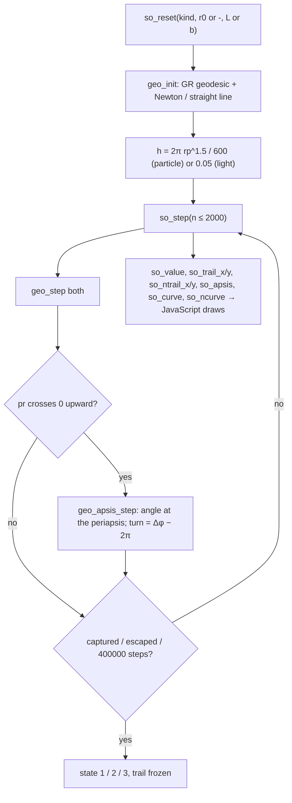

**Code.** `so_reset`, `so_step`, `so_value`, `so_trail_x`, `so_trail_y`, `so_ntrail_x`, `so_ntrail_y`, `so_apsis`, `so_curve`, `so_ncurve` in `src/orbit.c`; the terminal's `--orbit` (docs/orbit.svg) uses the same adapter.

**Tests.** `test_adapter` in `tests/test_schwarzschild.c`; the smoke test compares the WebAssembly build with `./test_schwarzschild --trace` and drives the real controls. Measured: `adapter-precession` (9e-10 off the elliptic integral after 200 000 steps), `adapter-drift`, `adapter-deflection`, `adapter-plunge`.

## References

- K. Schwarzschild (1916), Über das Gravitationsfeld eines Massenpunktes nach der Einsteinschen Theorie.
- A. Einstein (1915), Erklärung der Perihelbewegung des Merkur aus der allgemeinen Relativitätstheorie; (1916) Die Grundlage der allgemeinen Relativitätstheorie.
- F. W. Dyson, A. S. Eddington, C. Davidson (1920), A determination of the deflection of light by the Sun's gravitational field.
- C. W. Misner, K. S. Thorne, J. A. Wheeler (1973), Gravitation, chapter 25.
- H. Yoshida (1990), Construction of higher order symplectic integrators, Physics Letters A 150.
