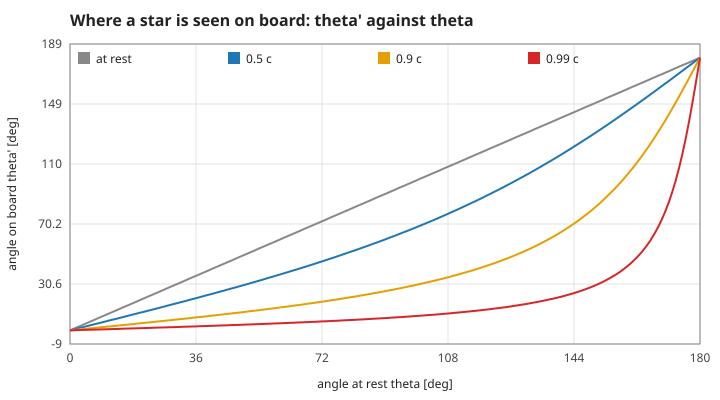
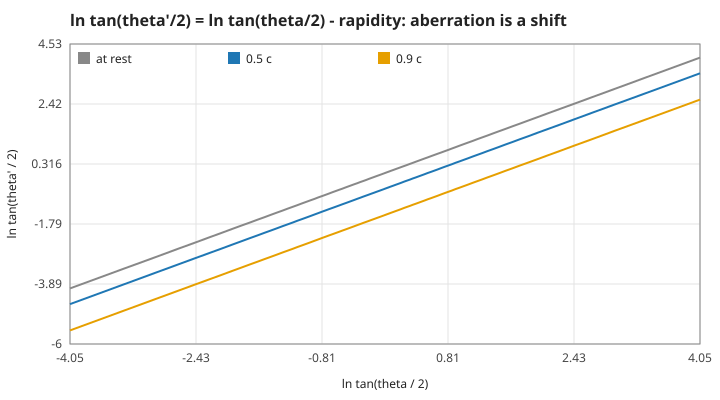
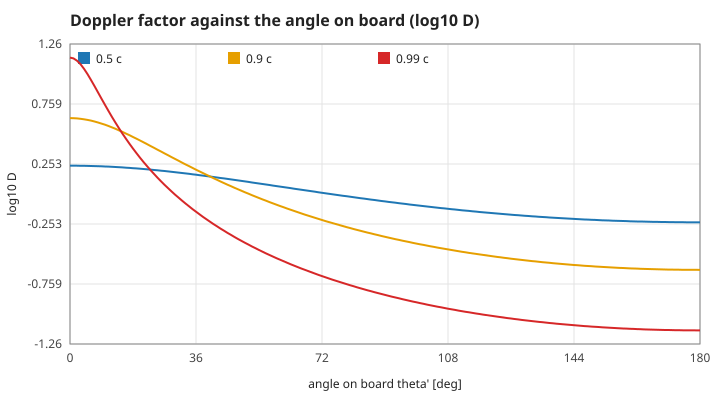
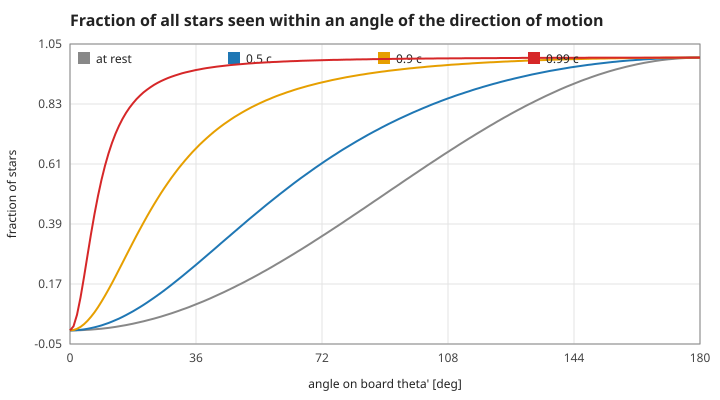
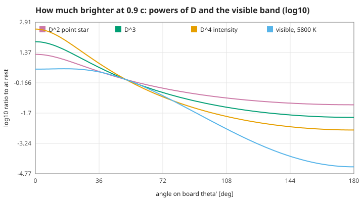
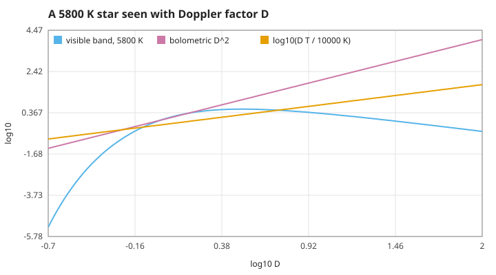
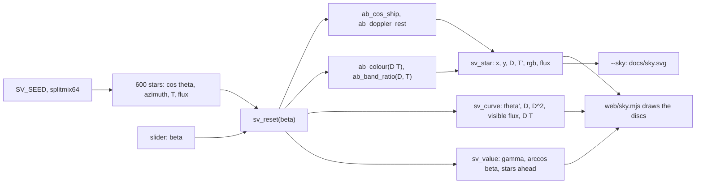

# 6. The view from the window: aberration, Doppler shift and brightness

What the rider sees out of the window at speed: stars move toward the direction of motion, ahead they turn blue and bright, behind red and faint. Measured numbers are quoted by their id in [figures/values.md](figures/values.md).

Units: $c = 1$; the ship's speed is $\beta = v/c$ and $\gamma = 1/\sqrt{1 - \beta^2}$. Angles are measured from the direction of motion to the direction in which a star is **seen**: $\theta$ in the Earth frame (the frame of the stars), $\theta'$ on board. Temperatures are in kelvin, wavelengths in nanometres, brightness as a ratio to the same star seen at rest. Nothing on this page changes the rocket of pages 1–4 or its outputs; it adds `src/aberration.c` (the laws) and `src/skyview.c` (the browser's star catalogue).

[Back to the index](README.md)

## S31 — Aberration: stars are seen further forward

**Statement.** A star seen at angle $\theta$ from the direction of motion in the Earth frame is seen on a ship moving at $\beta$ at

$$\cos\theta' = \frac{\cos\theta + \beta}{1 + \beta\cos\theta}, \qquad \cos\theta = \frac{\cos\theta' - \beta}{1 - \beta\cos\theta'}.$$

The directions straight ahead ($\theta = 0$) and straight behind ($\theta = \pi$) stay put; every other star moves toward the front. A star square to the motion ($\theta = 90°$) is seen at $\cos\theta' = \beta$.

**Assumptions and where they break.** The ship moves uniformly (an accelerating ship sees, at each instant, the sky of its momentary rest frame; that is how the rocket of page 2 would see it). The stars are far enough that their own motion and the light-travel time across the field do not matter (a nearby moving object would also show the time-of-flight distortions of the Terrell–Penrose rotation, which are not modelled). Only directions are treated here; parallax is ignored.

**Derivation.** Light from the star travels along $-(\cos\theta, \sin\theta)$ with 4-momentum $k = \omega(1, -\cos\theta, -\sin\theta)$. The Lorentz transformation of S02 into the ship's frame changes only $k^t$ and $k^x$: $\omega' = \gamma\omega(1 + \beta\cos\theta)$ and $k'^x = -\gamma\omega(\cos\theta + \beta)$, while $k'^y = k^y$. The direction seen on board is $\cos\theta' = -k'^x/\omega'$, which is the formula. Running it with $-\beta$ undoes it.

**Code.** `ab_cos_ship` and `ab_cos_rest` in `src/aberration.c`.

**Tests.** `test_known_values`, `test_identity_and_round_trip` and `test_against_boost` in `tests/test_aberration.c` (the aberration also obtained from the boosted wave vector of `boost` in `src/relativity.c`, within 1e-12). Measured: `ab-90-0.5` (60°), `ab-90-0.9` (25.84°), `ab-round-trip` (2.6e-15 after $\beta$ then $-\beta$), `ab-identity` (at $\beta = 1\times10^{-12}$ the change is the first-order term $\beta\sin^2\theta$ and vanishes with $\beta$).

## S32 — Aberration is a shift by the rapidity, so it composes like velocity addition

**Statement.** In the variable $\ln\tan(\theta/2)$ aberration is a plain shift by the rapidity $\varphi = \operatorname{atanh}\beta$ of S03:

$$\tan\frac{\theta'}{2} = \sqrt{\frac{1 - \beta}{1 + \beta}}\,\tan\frac{\theta}{2} = e^{-\varphi}\tan\frac{\theta}{2}.$$

Two aberrations in a row along the same line, at $\beta_1$ then $\beta_2$, equal one aberration at the relativistic sum $(\beta_1 + \beta_2)/(1 + \beta_1\beta_2)$.

**Assumptions and where they break.** Both boosts along the same line (boosts along different lines compose to a boost and a rotation, the Thomas–Wigner rotation, not treated here).

**Derivation.** With $t = \tan(\theta/2)$, $\cos\theta = (1 - t^2)/(1 + t^2)$; inserting into S31 and simplifying gives $t' = t\sqrt{(1 - \beta)/(1 + \beta)}$. A shift by $-\varphi_1$ followed by $-\varphi_2$ is a shift by $-(\varphi_1 + \varphi_2)$, and rapidities add (S03).

**Code.** `ab_theta_ship` (the rapidity form) and `ab_rapidity` in `src/aberration.c`, against `ab_cos_ship`.

**Tests.** `test_identity_and_round_trip` (the two forms agree within 1e-13) and `test_composition` in `tests/test_aberration.c` (compared with `add_velocity` of `src/relativity.c`). Measured: `ab-shift` ($-\operatorname{atanh}0.9 = -1.4722$ at 60°), `ab-compose` (5.8e-15 over 42 pairs of speeds).

## S33 — The Doppler factor: blue ahead, red behind, and two "sideways" shifts

**Statement.** Every frequency of a star's light is multiplied by the Doppler factor

$$D = \frac{\nu'}{\nu} = \gamma(1 + \beta\cos\theta) = \frac{1}{\gamma(1 - \beta\cos\theta')}.$$

The first form uses the Earth-frame angle, the second the angle on board; they are equal because the angles are related by S31. Straight ahead $D = \sqrt{(1 + \beta)/(1 - \beta)}$, straight behind its inverse. "Sideways" is ambiguous: a star at 90° in the Earth frame is blue-shifted by $\gamma$; a star **seen** at 90° on board is red-shifted by $1/\gamma$ (time dilation of the ship's clock). Colours are unchanged at the ship angle $\cos\theta' = (1 - 1/\gamma)/\beta$.

**Assumptions and where they break.** As S31. The stars are at rest in the Earth frame (their own speeds of a few hundred km/s are ignored).

**Derivation.** $D = \omega'/\omega$ is the time component of the boosted wave vector in S31. Inverting, $\omega = \gamma\omega'(1 - \beta\cos\theta')$, which is the second form. Going back from the ship to the Earth multiplies by $1/D$, which is $D$ computed with $-\beta$ at the ship angle.

**Code.** `ab_doppler_rest`, `ab_doppler_ship` and `ab_gamma` in `src/aberration.c`.

**Tests.** `test_known_values`, `test_identity_and_round_trip` ($D(\beta)\,D(-\beta) = 1$ and the two forms within 1e-13) and `test_against_boost` (D against $\omega'/\omega$ of `boost`, within 1e-13) in `tests/test_aberration.c`. Measured: `doppler-ahead` ($\sqrt{19}$ at 0.9 c), `doppler-behind`, `doppler-side-rest` ($\gamma$), `doppler-side-ship` ($1/\gamma$), `doppler-unshifted` (64.2° at 0.9 c), `doppler-boost` (1.6e-15).

## S34 — Stars crowd ahead: the solid angle shrinks by D squared

**Statement.** A patch of sky of solid angle $d\Omega$ at rest is seen on board as

$$d\Omega' = \frac{d\Omega}{D^2},$$

so the number of stars per solid angle is multiplied by $D^2$ (19 times straight ahead at 0.9 c), while the number of stars is unchanged. Stars spread evenly over the Earth-frame sky are seen within $\theta'$ of the direction of motion with fraction

$$F(\theta') = \frac{1 - \cos\theta}{2}, \quad \cos\theta = \frac{\cos\theta' - \beta}{1 - \beta\cos\theta'};$$

in particular half of all stars sit inside $\theta' = \arccos\beta$ (25.8° at 0.9 c, 8.1° at 0.99 c), and $(1 + \beta)/2$ of them are in the front hemisphere.

**Assumptions and where they break.** As S31. The star catalogue of the browser is one random sky (600 stars, even over the sphere), so its counts scatter by about $\sqrt{N p(1 - p)}$ around the expected numbers; the cone of half-angle $\arccos\beta$ holds exactly the stars of the rest-frame front half, star by star.

**Derivation.** $d\Omega = d(\cos\theta)\,d\phi$ and the azimuth $\phi$ round the motion is unchanged, so $d\Omega'/d\Omega = d\cos\theta'/d\cos\theta$. Differentiating S31, $d\cos\theta'/d\cos\theta = (1 - \beta^2)/(1 + \beta\cos\theta)^2 = 1/D^2$. Integrating it over the whole sky gives $4\pi$ again. The cone: $\cos\theta' = \beta$ maps back to $\cos\theta = 0$.

**Code.** `ab_solid_angle`, `ab_cone_fraction` and `ab_half_cone` in `src/aberration.c`; the catalogue counts in `sv_reset` of `src/skyview.c`.

**Tests.** `test_solid_angle_and_counts` in `tests/test_aberration.c` (finite differences of S31 against $1/D^2$ within 1e-6, the integral over the sky within 1e-7 of $4\pi$, the catalogue count ahead within 4 standard deviations, the cone star by star). Measured: `solid-jacobian` (1.2e-9), `solid-total` ($4\pi$ to 1.3e-9 at 0.99 c), `density-ahead` (19), `cone-half`, `catalogue-ahead` (573 of 600 against 570), `catalogue-cone` (298 = 298).

## S35 — Brightness: which power of D

**Statement.** The specific intensity divided by the cube of the frequency is the same in every frame [Rybicki & Lightman 1979, §4.9]:

$$\frac{I_\nu}{\nu^3} = \frac{I'_{\nu'}}{\nu'^3} \;\Rightarrow\; I'_{\nu'}(\nu') = D^3\,I_\nu(\nu'/D), \qquad I' = \int I'_{\nu'}\,d\nu' = D^4 I.$$

What a star looks like then depends on which quantity is meant. The powers used on this page:

| Quantity | Factor | Why |
|---|---|---|
| specific intensity at the shifted frequency | $D^3$ | the invariant $I_\nu/\nu^3$ |
| bolometric intensity (surface brightness) | $D^4$ | one more $D$ from $d\nu' = D\,d\nu$ |
| solid angle of a patch, or of a star's disc | $D^{-2}$ | S34 |
| bolometric flux of a **point star at rest**, seen by the moving ship | $D^2$ | intensity times solid angle, $D^4 \cdot D^{-2}$ |
| the same written with the distance measured on board, $r' = D\,r$ | $D^4$ (at fixed $r'$) | $D^2/r^2 = D^4/r'^2$ |
| flux density of a power-law spectrum $F_\nu \propto \nu^{-\alpha}$ at a fixed observed frequency | $D^{1+\alpha}$ | $F'_{\nu'}(\nu') = D\,F_\nu(\nu'/D)$ |

The often-quoted $D^3$ and $D^4$ for a point source belong to a moving **source** (a steady jet and a discrete blob, flux densities $D^{2+\alpha}$ and $D^{3+\alpha}$) with the distance taken in the observer's frame; for the rider moving through resting stars at a given distance in the stars' frame, the bolometric flux grows as $D^2$. The program uses $D^2$ (through the visible band, S36).

**Assumptions and where they break.** The star's light is a steady, unpolarised beam; no extinction between star and ship. The table's $D^{1+\alpha}$ is for a pure power law; a black body is treated exactly in S36.

**Derivation.** The photon phase-space density is invariant, which gives $I_\nu/\nu^3$; integrate over $\nu'$ with $\nu' = D\nu$ for $D^4$. A distant star of solid angle $\Delta\Omega$ has flux $F = I\,\Delta\Omega$, and on board $F' = D^4 I\cdot\Delta\Omega/D^2$. The light that arrives now left the star a distance $r$ away in the star's frame; that emission event is $D\,r$ away on board (the null separation transforms like the wave vector), which turns $D^2/r^2$ into $D^4/r'^2$.

**Code.** `ab_planck` and `ab_band` in `src/aberration.c` (the black body and its band integral); the flux of each star in `sv_reset` of `src/skyview.c` uses `ab_band_ratio`.

**Tests.** `test_intensity_powers` in `tests/test_aberration.c` ($D^3 B(\nu/D, T) = B(\nu, DT)$ within 1e-12; the whole-spectrum integral equals $(T/C_2)^4\pi^4/15$ and grows as $D^4$, within 1e-6) and `test_against_boost` (the emission event at $D\,r$). Measured: `planck-invariance` (6.7e-16), `stefan-d4` (361 at $D = \sqrt{19}$, 1.6e-13), `flux-d2` (19), `distance-d` ($\sqrt{19}$ light-years for light that left 1 yr ago).

## S36 — Colour and the visible band: blue, then invisible

**Statement.** A black body at temperature $T$ seen with Doppler factor $D$ is a black body at $T' = D\,T$ (from S35: $D^3 B_\nu(\nu/D, T) = B_\nu(\nu, DT)$), so its colour follows the temperature and its peak wavelength $\lambda_{\max} = b/T'$ with Wien's constant $b = 2.8978\times10^{6}$ nm K. Its flux in the visible band (380–750 nm) is

$$\frac{F'_{\rm vis}}{F_{\rm vis}} = \frac{1}{D^2}\,\frac{\int_{\rm vis} B_\nu(\nu, DT)\,d\nu}{\int_{\rm vis} B_\nu(\nu, T)\,d\nu},$$

which, unlike the bolometric $D^2$, does not grow without bound: for a 5800 K star it rises to about 3.5 at $D \approx 3.2$ and falls below 1 again beyond $D \approx 25$, when most of the light has moved into the ultraviolet. Straight ahead at 0.99 c ($D = 14.1$) a 5800 K star glows at 82,000 K and is only 1.66 times its resting visible brightness.

**Assumptions and where they break.** Stars are treated as black bodies (real spectra have lines and an ultraviolet cut-off); the eye's sensitivity is replaced by a flat band of 380–750 nm; the display colour samples three wavelengths (610, 550 and 465 nm) normalised to white at 6500 K, a simple stand-in for a colour-matching function.

**Derivation.** With $x = h\nu/kT$, $B_\nu \propto \nu^3/(e^{h\nu/kT} - 1)$; substituting $\nu \to \nu/D$ and multiplying by $D^3$ replaces $T$ by $DT$. The flux density at a fixed frequency is $D\,F_\nu(\nu/D) = D^{-2}B_\nu(\nu, DT)\,\Delta\Omega$ (S35); integrate over the band. At small $D$ the band is in the Wien tail and the ratio falls steeply; at large $D$ it is in the Rayleigh–Jeans part, where $B_\nu \propto \nu^2 T$, so the ratio falls like $D^{-1}$. The maximum of $B_\lambda$ solves $x = 5(1 - e^{-x})$, $x = 4.965$, which is Wien's law.

**Code.** `ab_band_ratio`, `ab_peak_nm` and `ab_colour` in `src/aberration.c`.

**Tests.** `test_intensity_powers` (the 400-interval Simpson band within 1e-10 of a 40,000-interval one; brighter ahead, fainter behind; a very large $D$ dimmer than a moderate one) and `test_wien_and_colour` (the peak of $B_\lambda$ by golden-section search within 1e-7 of `ab_peak_nm`, red at 3000 K, white at 6500 K, blue at 20,000 K) in `tests/test_aberration.c`. Measured: `wien`, `colour-white`, `band-peak` (3.53), `band-peak-d` (3.22), `band-back` (25.5), `band-0.99` (1.66).

## S37 — The browser's window and the terminal's sky chart

**Statement.** The section "The view from the window" of the observatory and `./relativity-rider --sky` (docs/sky.svg) draw one fixed catalogue of 600 stars at rest, as the ship sees it at a chosen $\beta$. Every star's direction, Doppler factor, colour temperature, display colour and visible-band flux comes from the C model; JavaScript only reads the numbers and draws the dots. Each disc is the whole sky centred on the direction of motion, at radius $\theta/180°$ (an azimuthal equidistant map), so the rim is straight behind.

**Assumptions and where they break.** The catalogue is the only random thing: positions and, from a separate sub-seed, temperatures (3000–15000 K, even in $\log T$) and magnitudes (0–5) are drawn once from the fixed seed `SV_SEED` with splitmix64 and never depend on $\beta$. It is an illustration, not a real star map. Dot sizes are a display choice (logarithmic in flux, clamped). The speed is set directly; the window does not follow the rocket of pages 1–4 or the story.

**Derivation.** None beyond S31–S36: the adapter calls those functions for each star and for the curves on 181 angles.

**Code.** `sv_reset`, `sv_value`, `sv_star` and `sv_curve` in `src/skyview.c`; `sky_svg` in `src/main.c`.

**Tests.** `test_adapter` in `tests/test_aberration.c` (at rest the window is the rest sky; the catalogue does not depend on $\beta$; every star placed by the closed forms within 1e-12; out-of-range reads are NaN; resets are deterministic); `./test_aberration --trace` is compared value by value with the WebAssembly build by `make smoke`. Measured: `adapter-sky-d`, `adapter-sky-cone`, `adapter-sky-curve`, `adapter-sky-rest` (298 of 600 ahead at rest).
