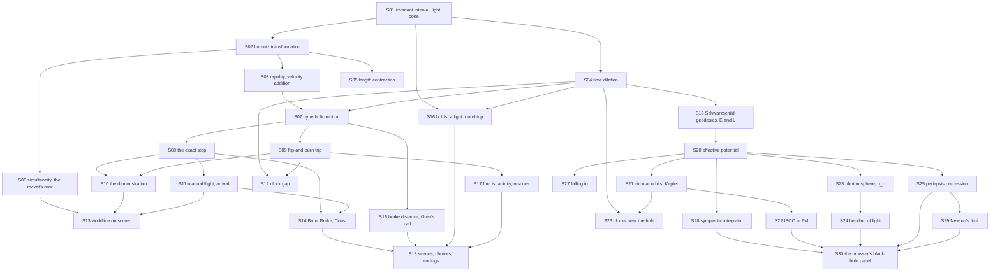

# Theory handbook

Why the program is correct, from the repository alone: every law, formula and rule the code relies on, each stated in Markdown **with a figure**, the place in the code that implements it, and the test or measurement that checks it.

- Units: $c = 1$; times in years, lengths in light-years, velocities as fractions of $c$. 1 g = 1.0323 ly/yr².
- Plotted figures and the numbers quoted in the text are produced by the program's own functions: `make theory-figs` rewrites [figures/](figures/) and [figures/values.md](figures/values.md). Diagrams are Mermaid, written in the pages.
- `make theory-check` fails when a statement has no figure, a link is broken, a referenced function or test no longer exists, or a public function is missing from the tables below.

## Pages

1. [Spacetime: intervals, boosts, rapidity, clocks and rods](01-spacetime.md) — the invariant interval and the light cone, the Lorentz transformation, rapidity and velocity addition, time dilation, length contraction, relativity of simultaneity
2. [The accelerating rocket](02-acceleration.md) — hyperbolic motion, the exact step, the flip-and-burn trip and its two clocks
3. [The program: flying, arriving and drawing](03-program.md) — the demonstration, manual flight and the arrival rule, the clock gap, the worldline on screen
4. [The Long Echo: the story trip on the same model](04-story.md) — Burn, Brake and Coast as exact steps, the brake distance and Oren's call, holds on a marker, fuel as rapidity and rescues, scenes and choices
5. [Orbits around a black hole (general relativity)](05-schwarzschild.md) — Schwarzschild geodesics and their conserved E and L, the effective potential, circular orbits and the innermost stable one at 6M, the photon sphere, the bending of light, the periapsis precession, clocks near the hole, falling in, the fourth-order symplectic integrator, Newton's limit, the browser's black-hole panel

## How the pieces depend on each other

## Coverage: statement → page → figure → code → test

| ID | Statement | Page | Figure | Code | Test |
|---|---|---|---|---|---|
| S01 | Invariant interval $t^2 - x^2$; the light cone | [1](01-spacetime.md) | `figures/boost.svg` | `src/relativity.c#interval2` | `tests/test_relativity.c#test_boost_preserves_the_interval` |
| S02 | Lorentz transformation as a hyperbolic rotation | [1](01-spacetime.md) | mermaid | `src/relativity.c#boost` | `tests/test_relativity.c#test_boost_preserves_the_interval`, `tests/theory_figs.c#boosts-compose` |
| S03 | Rapidity, $v = \tanh\varphi$, $\gamma = \cosh\varphi$, velocity addition | [1](01-spacetime.md) | `figures/rapidity.svg`, `figures/addition.svg` | `src/relativity.c#velocity`, `src/relativity.c#lorentz_gamma`, `src/relativity.c#add_velocity` | `tests/test_relativity.c#test_velocity_addition_never_exceeds_light` |
| S04 | Time dilation $\Delta t = \gamma\Delta\tau$ | [1](01-spacetime.md) | `figures/dilation.svg` | `src/relativity.c#rocket_step` | `tests/test_relativity.c#test_time_dilation_while_coasting` |
| S05 | Length contraction $L_0/\gamma$ | [1](01-spacetime.md) | `figures/contraction.svg` | `src/relativity.c#boost` | `tests/theory_figs.c#contraction-0.8` |
| S06 | Relativity of simultaneity: $t - t_0 = v(x - x_0)$ | [1](01-spacetime.md) | `figures/simultaneity.svg` | `src/relativity.c#boost`, `src/rider.c#rr_value` | `tests/test_rider.c#test_interval_and_trail`, `tests/theory_figs.c#now-line` |
| S07 | Constant proper acceleration: hyperbolic motion | [2](02-acceleration.md) | `figures/hyperbola.svg`, `figures/speed.svg` | `src/relativity.c#rocket_step` | `tests/test_relativity.c#test_hyperbolic_motion_matches_closed_form`, `tests/test_relativity.c#test_worldline_is_a_hyperbola` |
| S08 | The step is exact for any size | [2](02-acceleration.md) | mermaid | `src/relativity.c#rocket_step` | `tests/test_rider.c#test_adapter_is_identical_to_rocket_api`, `tests/theory_figs.c#step-size-x` |
| S09 | Flip-and-burn: ship time and Earth time | [2](02-acceleration.md) | `figures/trip.svg` | `src/rider.c#rr_reset`, `src/main.c#headless` | `tests/test_relativity.c#test_flip_and_burn_trip` |
| S10 | The demonstration: 800 exact steps | [3](03-program.md) | `figures/demo.svg` | `src/rider.c#rr_reset`, `src/rider.c#rr_step` | `tests/test_rider.c#test_demo_matches_closed_form` |
| S11 | Manual flight and the arrival rule | [3](03-program.md) | mermaid | `src/rider.c#rr_thrust`, `src/rider.c#at_rest_on_star` | `tests/test_rider.c#test_manual_controls` |
| S12 | The clock gap $t - \tau$ | [3](03-program.md) | `figures/demo.svg` | `src/rider.c#rr_value` | `tests/test_rider.c#test_demo_matches_closed_form` |
| S13 | The worldline on the screen | [3](03-program.md) | mermaid | `src/rider.c#rr_trail_t`, `src/rider.c#rr_trail_x`, `src/render.c#render_frame` | `tests/test_rider.c#test_interval_and_trail`, `tests/test_relativity.c#test_render_fits_the_screen` |
| S14 | Burn, Brake, Coast: the story moves the rocket only by exact steps | [4](04-story.md) | mermaid | `src/courier.c#courier_tick`, `src/relativity.c#rocket_step` | `tests/test_courier.c#[physics]` |
| S15 | Brake distance $(\cosh\varphi - 1)/a$, the wobbling readout, Oren's call | [4](04-story.md) | mermaid | `src/courier.c#courier_brake_distance`, `src/courier.c#courier_wobble`, `src/courier.c#courier_call_on`, `src/courier.c#courier_cue` | `tests/test_courier.c#[mech] pad` |
| S16 | Holds on a marker: a light round trip, the tanker | [4](04-story.md) | mermaid | `src/courier.c#courier_calibration_hold`, `src/courier.c#courier_hold_need` | `tests/test_courier.c#[mech] gate`, `tests/test_courier.c#[mech] star` |
| S17 | Fuel is rapidity; leaks and rescues | [4](04-story.md) | mermaid | `src/courier.c#courier_leak`, `src/courier.c#catch_rocket`, `src/courier.c#rescue` | `tests/test_courier.c#[mech] dust`, `tests/test_courier.c#[mech] silence` |
| S18 | Scenes, choices, heavy scenes, endings | [4](04-story.md) | mermaid | `src/courier.c#courier_init`, `src/courier.c#courier_answer`, `src/courier.c#courier_options`, `src/courier.c#courier_heavy`, `src/courier.c#courier_ending`, `src/courier.c#courier_value` | `tests/test_courier.c#[order]`, `tests/test_courier.c#[quiet] dust`, `tests/test_courier.c#[choice]` |
| S19 | Schwarzschild geodesics: $E$ and $L$ conserved, $dt/d\tau = E/(1 - 2M/r)$, $d\varphi/d\tau = L/r^2$ | [5](05-schwarzschild.md) | `figures/geo-conserved.svg` | `src/schwarzschild.c#geo_init`, `src/schwarzschild.c#geo_rate`, `src/schwarzschild.c#geo_from_apsides`, `src/schwarzschild.c#geo_energy` | `tests/test_schwarzschild.c#test_conserved_quantities`, `tests/theory_figs.c#geo-e-fd` |
| S20 | Effective potential $V(r)$, radial equation $\ddot r = -V'$ | [5](05-schwarzschild.md) | `figures/potential.svg` | `src/schwarzschild.c#geo_potential`, `src/schwarzschild.c#geo_force`, `src/orbit.c#so_curve`, `src/orbit.c#so_ncurve` | `tests/test_schwarzschild.c#test_potential_and_force`, `tests/theory_figs.c#potential-extra` |
| S21 | Circular orbits $r_\pm$, $d\varphi/dt = \sqrt{M/r^3}$ | [5](05-schwarzschild.md) | `figures/circular.svg` | `src/schwarzschild.c#geo_circular_L`, `src/schwarzschild.c#geo_circular_radius`, `src/schwarzschild.c#geo_unstable_radius` | `tests/test_schwarzschild.c#test_circular_orbits`, `tests/theory_figs.c#circular-kepler` |
| S22 | Innermost stable circular orbit at $6M$ | [5](05-schwarzschild.md) | `figures/isco.svg` | `src/schwarzschild.c#geo_isco` | `tests/test_schwarzschild.c#test_isco`, `tests/theory_figs.c#isco-scan` |
| S23 | Photon sphere $3M$, capture below $b_c = 3\sqrt3 M$ | [5](05-schwarzschild.md) | `figures/light.svg` | `src/schwarzschild.c#geo_photon_sphere`, `src/schwarzschild.c#geo_critical_b` | `tests/test_schwarzschild.c#test_light`, `tests/theory_figs.c#photon-bcrit` |
| S24 | Bending of light $4M/b + (15\pi/4)(M/b)^2$ | [5](05-schwarzschild.md) | `figures/deflection.svg` | `src/schwarzschild.c#geo_swept_angle`, `src/schwarzschild.c#geo_deflection_weak` | `tests/test_schwarzschild.c#test_light`, `tests/theory_figs.c#deflection-quadrature` |
| S25 | Periapsis precession: elliptic integral and $6\pi M/p$ | [5](05-schwarzschild.md) | `figures/precession.svg`, `figures/rosette.svg` | `src/schwarzschild.c#geo_precession_exact`, `src/schwarzschild.c#geo_precession_weak`, `src/schwarzschild.c#geo_apsides`, `src/schwarzschild.c#geo_apsis_step` | `tests/test_schwarzschild.c#test_precession`, `tests/theory_figs.c#precession-integrated` |
| S26 | Clocks: $\sqrt{1 - 2M/r}$ at rest, $\sqrt{1 - 3M/r}$ in orbit | [5](05-schwarzschild.md) | `figures/gr-clocks.svg` | `src/schwarzschild.c#geo_static_rate`, `src/schwarzschild.c#geo_circular_rate`, `src/schwarzschild.c#geo_local_speed` | `tests/test_schwarzschild.c#test_circular_orbits`, `tests/theory_figs.c#clock-split` |
| S27 | Radial fall: finite proper time, unbounded $dt/d\tau$ | [5](05-schwarzschild.md) | `figures/fall.svg` | `src/schwarzschild.c#geo_fall_time` | `tests/test_schwarzschild.c#test_fall`, `tests/theory_figs.c#fall-3` |
| S28 | Fourth-order symplectic composition, bounded energy error | [5](05-schwarzschild.md) | `figures/order.svg`, mermaid | `src/schwarzschild.c#geo_step`, `src/schwarzschild.c#geo_leapfrog` | `tests/test_schwarzschild.c#test_order`, `tests/theory_figs.c#order-fourth` |
| S29 | Newton's limit and the comparison orbit | [5](05-schwarzschild.md) | `figures/newton-limit.svg` | `src/schwarzschild.c#GEO_NEWTON` | `tests/test_schwarzschild.c#test_newton_limit`, `tests/theory_figs.c#newton-limit` |
| S30 | The browser's black-hole panel and the terminal's orbit chart | [5](05-schwarzschild.md) | mermaid | `src/orbit.c#so_reset`, `src/orbit.c#so_step`, `src/orbit.c#so_value`, `src/orbit.c#so_trail_x`, `src/orbit.c#so_trail_y`, `src/orbit.c#so_ntrail_x`, `src/orbit.c#so_ntrail_y`, `src/orbit.c#so_apsis`, `src/main.c#orbit_svg` | `tests/test_schwarzschild.c#test_adapter`, `tests/theory_figs.c#adapter-precession` |

Tests named `tests/theory_figs.c#…` are measurements recorded in [figures/values.md](figures/values.md) by `make theory-figs`, not assertions of `make test`. S05 is covered only that way (the program has no length function).

One thing the measurements made visible (not changed here): for a proper acceleration that is tiny but above the coasting threshold of 1e-12 per step, `rocket_step` divides a rounding error by $a$ — with $a = 10^{-9}$ the position is off by 3e-8 ly after 0.3 yr (S08). The game only uses 0 and ±1 g.

## Public functions that state no law

| Function | What it is |
|---|---|
| `src/svg.c#svg_plot` | writes the line charts of this handbook and of `make plots` |
| `src/svg.c#svg_xy` | writes the orbit and light-ray charts (equal axes, rings for the horizon, the photon sphere and 6M) |
| `src/gif.c#gif_open`, `src/gif.c#gif_frame`, `src/gif.c#gif_close`, `src/gif.c#gif_text_size`, `src/gif.c#gif_draw_text` | GIF89a/LZW encoder for the demo animation |

## Reading the source against this table

Functions reviewed for this handbook: every declaration in `src/relativity.h`, `src/rider.h`, `src/courier.h`, `src/render.h`, `src/svg.h`, `src/gif.h`, `src/schwarzschild.h` and `src/orbit.h`; the static helpers `kick`, `drift`, `kdk`, `roots`, `polish`, `g_of`, `sweep`, `circular` and `ellip_k` in `src/schwarzschild.c` and `record`, `add_apsis`, `advance`, `curve_r` and `trail_at` in `src/orbit.c`; `orbit_svg` in `src/main.c`; the static helpers `record`, `at_rest_on_star` and `finished` in `src/rider.c` and `calibrated`, `range`, `open_scene`, `raise_banner`, `start_leg`, `clear_leg`, `fail`, `hop_need`, `catch_rocket`, `rescue` in `src/courier.c`; `headless` in `src/main.c`; the wrappers of `src/courier_web.c`, which only forward to `courier_init`, `courier_tick`, `courier_answer` and `courier_value`. The bench's pilot (tests/courier_policy.h) is test code, not a rule of the game.

The story layer (S14–S18) adds `src/courier.c` on top of the unchanged model. The black-hole page (S19–S30) adds `src/schwarzschild.c` and `src/orbit.c` beside it; the special-relativity model, its outputs and the story rows are unchanged by it. The model and the game are unchanged by this handbook: it adds `tests/theory_figs.c`, `scripts/theory-check.py`, two Makefile targets and these pages.
